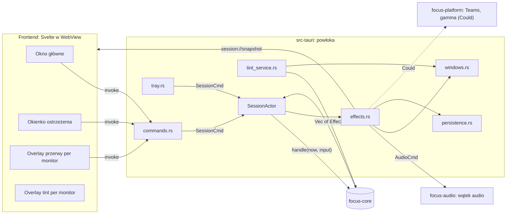
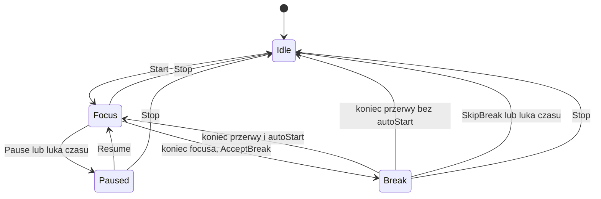

# FocusMode — Architektura

> Status: **wersja 3** — po dwóch cross-review ([2026-09-27](reviews/codex-crosscheck-2026-09-27.md), [2026-10-06](reviews/codex-review-2026-10-06.md); poprawki R01–R09).
> Decyzje: [DECISIONS.md](DECISIONS.md). Produkt i profil czasów: [DESIGN.md](DESIGN.md).
>
> **Uwaga (2026-10-13):** aktualny zakres to [ADR-013](DECISIONS.md#adr-013-speedrun-pivot-produktu) (speedrun)
> + [ADR-014](DECISIONS.md#adr-014-zasobnik-i-okienka-faz-odcień-ekranu-overlay-zamykanie-launcherów-gier-języki) (zasobnik i okienka faz, odcień ekranu jako overlay, launchery gier, języki).
> Aktualny jest §6 (kontrakt IPC, zgodny z `api.rs`). Pozostałe sekcje są sprzed pivotu (okna przerwy, ostrzeżenie, tryb spotkania, tint, muzyka w rodio).
> Tam, gdzie różnią się od ADR-013 i ADR-014, wygrywają ADR-y (task SR-09).

## 1. Stos technologiczny w skrócie

| Warstwa | Technologia | Po co |
|---|---|---|
| Powłoka / okna / tray | **Tauri 2** (Rust) | okna (także overlaye per monitor), tray, powiadomienia, instalatory — bez ręcznego HWND |
| Logika domenowa | **Rust**, crate `focus-core` | profil czasów, maszyna stanów, planer przerwy, walidacja configu, agregaty statystyk — czysta, bez I/O |
| Audio | **rodio** w `focus-audio` | odtwarzanie plików, generowany szum, fade |
| Integracje OS | `focus-platform` | (Could) Teams DND przez Graph, eksperymentalna gamma ramp |
| UI | **Svelte 5 + TypeScript + Vite** w WebView | szybki, ładny interfejs; animacje CSS |
| Typy UI↔Rust | **ts-rs** (`#[ts(export)]`) | typy TS generowane z DTO w Ruście |
| Build | `tauri build`, GitHub Actions | instalator Windows (NSIS/MSI) od M1; macOS/Linux w CI best-effort |

Platforma odbioru to Windows, pozostałe best-effort z tabelą ograniczeń (DESIGN §4, ADR-008).
Tauri nie gwarantuje identycznego UX na każdym OS; to, co obiecujemy, sprawdzamy testami na sprzęcie.

## 2. Układ repozytorium

```
.
├── Cargo.toml                 # workspace: crates/* + src-tauri
├── Cargo.lock                 # commitowany; CI buduje z --locked
├── rust-toolchain.toml        # przypięta wersja Rusta
├── .nvmrc                     # przypięta wersja Node
├── .cargo/config.toml         # [env] TS_RS_EXPORT_DIR = src/lib/bindings (relative = true)
├── assets/
│   ├── exercises.json         # JEDYNY katalog ćwiczeń (czyta powłoka → planer w core)
│   └── music/                 # genres.toml, pliki audio, CREDITS.md
├── crates/
│   ├── focus-core/            # ZERO zależności od Tauri/rodio/OS/sieci/systemu plików
│   │   └── src/
│   │       ├── api.rs         # DTO współdzielone z UI (#[ts(export)]) — KONTRAKT
│   │       ├── timing.rs      # TimingProfile { normal(), demo() } — jedyne źródło czasów
│   │       ├── clock.rs       # Now { mono, wall } — typy czasu (bez czytania zegara)
│   │       ├── session.rs     # maszyna stanów: Session::handle(now, Input) -> Vec<Effect>
│   │       ├── break_plan.rs  # planer przerwy: (katalog, profil, seed) -> BreakPlan
│   │       ├── config.rs      # Config + Default + walidacja + from/to TOML string (bez plików)
│   │       ├── stats.rs       # SessionRecord, agregaty dzienne, podsumowanie jednym zdaniem
│   │       └── tint.rs        # kelvin -> kolor/alfa overlay, harmonogram
│   ├── focus-audio/           # wątek audio (rodio), playlisty, generatory szumu, model fade
│   └── focus-platform/        # (Could) DndProvider/Teams, eksperymentalna gamma — za traitami
├── src-tauri/                 # powłoka (imperative shell)
│   ├── tauri.conf.json
│   ├── build.rs               # tauri_build + (Should) manifest komend aplikacji dla ACL
│   ├── capabilities/          # uprawnienia per typ okna
│   └── src/
│       ├── main.rs            # tylko focusmode_lib::run()
│       ├── lib.rs             # Builder, pluginy, setup, rejestracja komend       [B]
│       ├── commands.rs        # cienkie adaptery #[tauri::command] → SessionCmd   [B]
│       ├── session_actor.rs   # aktor: Session + tick + dispatch efektów          [A]
│       ├── effects.rs         # Effect → audio / okna / persystencja / eventy     [A]
│       ├── persistence.rs     # odczyt/zapis config.toml, sessions.jsonl, katalog [A]
│       ├── windows.rs         # main, warning, break-{n}, tint-{n} + bootstrap    [B]
│       ├── tray.rs                                                                [B]
│       └── tint_service.rs    # harmonogram → okna tint                           [A]
├── src/                       # FRONTEND: SvelteKit w trybie SPA (adapter-static, ssr=false) — nie Rust!
│   ├── app.html               # szablon SvelteKit; routing okien (#/break itd.): decyzja B — router hash SvelteKit lub własny
│   ├── lib/
│   │   ├── api.ts             # JEDYNE miejsce z invoke()/listen()
│   │   ├── bindings/          # GENEROWANE przez ts-rs — nie edytować
│   │   ├── stores/            # session store: snapshot + rewizje
│   │   ├── components/        # TimerRing, GenrePicker, ExerciseCard, HoldToSkip, ...
│   │   ├── illustrations/     # SVG/komponenty po id ćwiczenia + fallback
│   │   └── strings.ts         # teksty UI
│   └── routes/                # SvelteKit: +page.svelte (main), warning/, break/, tint/, settings/, stats/
└── docs/
```

## 3. Diagram komponentów



## 4. Wzorzec: functional core, imperative shell (ADR-002)

```rust
// crates/focus-core (szkic — nazwy do ustalenia w T0-4)
pub struct Now { pub mono: Duration /* od startu aplikacji, monotoniczny */, pub wall: OffsetDateTime /* lokalny kalendarz */ }

pub enum Input {
    Start { genre: GenreId },
    Pause, Resume, Stop,
    Tick,
    AcceptBreak,                          // „Idę” (tylko w ostrzeżeniu)
    Postpone,                             // „Jeszcze 2 min” (tylko w ostrzeżeniu, raz na cykl)
    SetMeetingMode { minutes: Option<u32> }, // None = wyłącz
    SkipBreak { break_id: BreakId },      // idempotentne, z ID konkretnej przerwy
    ConfigChanged(Config),
}

pub enum Effect {
    Audio(AudioCmd),                      // Play{genre}, Pause, Resume, FadeTo{factor, ms}, Stop, Gong
    ShowBreak { break_id: BreakId },      // plan jest w snapshocie, nie w efekcie
    HideBreak { break_id: BreakId },
    ShowWarning, HideWarning,
    Notify { title: String, body: String },   // tylko tekst
    RecordSession(SessionRecord),         // dokładnie raz na cykl; klucz (session_id, cycle)
    SetDnd { on: bool },                  // Could; to *docelowy stan*, uzgadnia go DndWorker (§7)
}

impl Session {
    pub fn new(profile: TimingProfile, catalog: ExerciseCatalog, seed: u64) -> Self;
    pub fn handle(&mut self, now: Now, input: Input) -> Vec<Effect>;
    pub fn snapshot(&self, now: Now) -> SessionSnapshot; // odtwarza CAŁY widok (§6.3)
}
```

Zasady:
- `focus-core` **nie czyta zegara, plików ani sieci**. `now`, katalog ćwiczeń i seed przychodzą z zewnątrz,
  więc testy są deterministyczne.
- Config w core to typy, `Default`, walidacja oraz `from_toml_str` / `to_toml_string`. **Pliki czyta i zapisuje powłoka** (`persistence.rs`).
- Wszystkie czasy pochodzą z `TimingProfile` (żadnych „magicznych” liczb w logice ani w UI; UI dostaje czasy w snapshocie).

## 5. Model czasu i maszyna stanów (ADR-011)

### 5.1 Profil czasów

| Parametr | `normal()` | `demo()` |
|---|---:|---:|
| `focus_secs` (ostrzeżenie się w nim zawiera) | 2400 | 40 |
| `warning_secs` | 30 | 5 |
| `break_secs` | 300 | 20 |
| `postpone_secs` (raz na cykl) | 120 | 10 |
| `meeting_options` | 15/30/60 min | 15 s |
| `interruption_gap_secs` | 60 | 60 |
| `min_walk_secs` (minimalny `stand-walk` na końcu przerwy) | 30 | 10 |

Długości faz z configu użytkownika nadpisują `normal()`. Demo ignoruje config i używa stałego planu przerwy.

**Walidacja configu** (core, `Config::validate`, R09): `focus_secs` ∈ [300, 7200], `break_secs` ∈ [60, 1800],
`warning_secs` < `focus_secs`, `postpone_secs` ∈ [60, 600]. Wartości spoza zakresu dają `AppError` z polem, a nie cichą korektę.
Arytmetyka czasu tylko `checked_*`/`saturating_*` (bez ujemnych reszt na `u32`).

**Planer przerwy** (`break_plan.rs`, R09): z przetasowanego (seed) katalogu bierze **co najwyżej 2** ćwiczenia, ale tylko takie,
dla których `suma + min_walk_secs ≤ break_secs`. Resztę wypełnia `stand-walk`. Przy krótkiej przerwie wychodzi 0–1 ćwiczenie + spacer.
Czasów ćwiczeń nie skracamy w trybie normalnym. Suma planu zawsze = `break_secs`.

### 5.2 Zegary
- **Fazy i deadline'y**: `now.mono` (monotoniczny). **Statystyki dzienne i harmonogram tint**: `now.wall`.
- **Heurystyka przerwania**: jeśli między tickami minęło > `interruption_gap_secs` w zegarze monotonicznym **albo**
  zegar kalendarzowy przeskoczył o tyle więcej niż monotoniczny, to sesja jest przerwana. Tak łapiemy uśpienie niezależnie od tego,
  czy dany OS wlicza suspend do `Instant`; fałszywym alarmem będzie np. ręczna zmiana zegara. Skutki:
  - w Focus → `Paused { reason: Interrupted }`, czeka na Resume; luka **nie** liczy się jako czas focusa,
  - w Break → Idle, wynik przerwy `interrupted` (nie zaliczamy ćwiczeń automatycznie).
- **Pauza zamraża pozostały czas, a nie przesuwa deadline'u** (R05). `Paused { remaining_secs }`; Resume ustawia `deadline = now + remaining`.
  - Pause użytkownika: `remaining = deadline − now`.
  - Przerwanie (luka): `remaining = deadline − last_trusted_tick`, czyli czas od ostatniego zaufanego ticka do wykrycia luki **nie** jest zużywany.
  - Przykład: deadline 40 s, ostatni zaufany tick 10 s, wykrycie 130 s, Resume 135 s → nowy deadline 165 s (30 s focusa zostaje, aktywny czas = 10 s).
- Czas aktywnej sesji = suma odcinków, w których Focus faktycznie biegł (do ostatniego zaufanego ticka; bez pauz i luk).
- Tryb spotkania: `meeting_until` (zegar monotoniczny). `meeting_active = meeting_until > now`.

### 5.3 Stany



Ostrzeżenie **nie jest osobną fazą**, tylko flagą `warning` w Focus (ostatnie `warning_secs`).
Tryb spotkania to pole `meeting_until` w Focus/Paused.

**Reguła spotkania (R01), wspólna dla wszystkich przejść:** dopóki `meeting_active`, **nie zaczyna się ani ostrzeżenie, ani przerwa**.
Włączenie spotkania w trakcie ostrzeżenia zeruje `warning`. Gdy spotkanie się kończy (wygaśnięcie albo `SetMeetingMode(None)`)
i do deadline'u zostało mniej niż `warning_secs` (albo deadline już minął), ustawiamy `deadline = now + warning_secs`
i od razu startuje **pełne** ostrzeżenie. „Idę” (AcceptBreak) działa tylko w ostrzeżeniu, więc w trakcie spotkania przerwy nie da się wymusić:
najpierw trzeba zakończyć spotkanie.

### 5.4 Pełna tabela: faza × wejście

`–` = ignorowane (no-op, bez błędu). Każde wejście jest idempotentne. „spotk.” = `meeting_active`.

| Faza \ wejście | Start | Pause | Resume | Stop | AcceptBreak | Postpone | SetMeetingMode | SkipBreak{id} | Tick |
|---|---|---|---|---|---|---|---|---|---|
| **Idle** | → Focus | – | – | – | – | – | – | – | – |
| **Focus** | – | → Paused(User, remaining) | – | → Idle, record(`stopped`) | – | – | ustaw / wyłącz (przy wyłączeniu: reguła spotkania) | – | spotk. → nic (przerwa czeka); koniec spotk. → reguła spotkania; bez spotk.: T−warn → `warning=true`, T → Break; luka → Paused(Interrupted) |
| **Focus + warning** | – | → Paused(User, remaining), `warning=false` | – | → Idle, record(`stopped`) | → Break | `deadline += postpone_secs`, `warning=false`, raz na cykl | ustaw → `warning=false` | – | T → Break (spotk. tu nie występuje); luka → Paused(Interrupted) |
| **Paused** | – | – | → Focus, `deadline = now + remaining`; jeśli bez spotk. i `remaining ≤ warning_secs` → `warning=true` | → Idle, record(`stopped`) | – | – | ustaw / wyłącz | – | nic (czas stoi) |
| **Break** | – | – | – | → Idle, record(`stopped`) | – | – | – | id zgodne → Idle, record(`skipped`); inne → – | koniec: autoStart ? → Focus : → Idle, record(`completed`); luka → Idle, record(`interrupted`) |

Efekty przejść:

| Przejście | Efekty |
|---|---|
| Idle → Focus | `Audio(Play)` z fade-in; (Could) `SetDnd{on}` |
| wejście w ostrzeżenie (także po końcu spotkania i po Resume) | `ShowWarning`, `Notify` (tekst), `Audio(FadeTo{0.3})` |
| wyjście z ostrzeżenia bez przerwy (Postpone / włączenie spotkania) | `HideWarning`, `Audio(FadeTo{1.0})` |
| Focus → Paused (User lub Interrupted) | `Audio(Pause)`, `HideWarning` (jeśli było) |
| Paused → Focus | `Audio(Resume)` (fade 1.0), a jeśli od razu ostrzeżenie: efekty wejścia w ostrzeżenie |
| Focus → Break | `HideWarning`, `ShowBreak{id}`, `Audio(FadeTo{0})`, `Audio(Gong)`; (Could) `SetDnd{off}` |
| zmiana ćwiczenia w Break | `Audio(Gong)` |
| Break → Focus | `HideBreak{id}`, `RecordSession`, `Audio(Play)`; (Could) `SetDnd{on}` |
| * → Idle | `Audio(Stop)`, `HideWarning`, `HideBreak`, `RecordSession` (jeśli był cykl), (Could) `SetDnd{off}` |

`RecordSession` zapisuje **dokładnie jeden** rekord na cykl (`session_id` + `cycle`), z wynikiem:
`completed | skipped | stopped | interrupted`.

### 5.5 Testy obowiązkowe (A-01)
Granice demo 34/35/39/40/60 s; Postpone raz (drugi ignorowany) i po nim ponowne ostrzeżenie; Stop w każdej fazie i Stop dwukrotny;
SkipBreak z cudzym `break_id`; luka w Focus i w Break; dokładnie jeden `RecordSession` na cykl; aktywny czas bez pauz.
**Spotkanie (R01):** włączone przed ostrzeżeniem i w trakcie ostrzeżenia (demo: spotkanie w 30 s na 15 s → brak przerwy w 40 s,
pełne ostrzeżenie 45–50 s, przerwa w 50 s); wygaśnięcie i ręczne wyłączenie po deadline; AcceptBreak w trakcie spotkania ignorowany.
**Pauza (R05):** oś z przykładu w §5.2 daje 30 s do przerwy i 10 s aktywnego focusa; Pause w ostrzeżeniu chowa okienko ostrzeżenia,
a Resume z `remaining ≤ warning_secs` pokazuje je ponownie.
**Planer i config (R09):** przerwa krótsza od, równa i dłuższa od sumy ćwiczeń + `min_walk_secs`; suma planu = `break_secs`, bez ujemnej reszty;
config spoza zakresów → błąd walidacji.

## 6. Kontrakt IPC (UI ↔ Rust) (ADR-006, ADR-012, ADR-013)

> Stan na 2026-10-13 (z ADR-019, tryb dewelopera), zgodny z `crates/focus-core/src/api.rs`. Przy rozbieżności wygrywa `api.rs`.

DTO w `crates/focus-core/src/api.rs`: `#[derive(Serialize, Deserialize, TS)]`, **`#[ts(export)]`**,
`#[serde(rename_all = "camelCase")]`. Liczby jako `u32` (unikamy `bigint` w TS); wyjątek to znaczniki czasu w ms od epoki Unix
(`i64` eksportowane jako `number` przez `#[ts(type = "number")]`): `startedAtMs` / `endedAtMs` w `SessionSummary` oraz czasy spotkań i przerw z ADR-016
(`Meeting.startMs` / `endMs`, `MeetingConflict.breakStartMs` / `breakEndMs` / `nextReminderMs`, `CalendarStatus.lastSyncMs`, `MeetingHoldView.untilMs`)
i z ADR-017 (`WorkItem.dueMs` / `updatedMs`, `WorkStatus.lastSyncMs`).
Eksport: `cargo test -p focus-core` zapisuje do `TS_RS_EXPORT_DIR` (ustawione w `.cargo/config.toml` względem workspace).
**CI sprawdza, czy po regeneracji `src/lib/bindings/` nie ma zmian** (`git diff --exit-code`).
Nazwy komend i eventów są stałymi w `api.rs` (`commands::*`, `events::*`), które test `export_names` zapisuje do `src/lib/bindings/names.ts`
(`COMMANDS`, `EVENTS`, `BRIDGE_PORT`), więc `api.ts` nie wpisuje ich ręcznie. Zmiany kontraktu przechodzą przez skill `/sync-contract`.

### 6.1 Komendy

Cienkie adaptery w `src-tauri/src/commands.rs`; logika w aktorze sesji, w wykonawcach efektów i w core.
Każda komenda zwraca `Result<T, AppError>`, gdzie `AppError { code, message, field }`: `code` to stabilny kod (`config.invalid`, `audio.device`,
`shields.notifications`, `teams.auth`, `media.url`…), `message` to szczegół po angielsku do logów (UI mapuje `code` na polski tekst),
a `field` to pole configu, które nie przeszło walidacji (`focusMinutes`, `music.volume`…). Argumenty `invoke` są w camelCase.

| Komenda | Argumenty | Zwraca | Uwagi |
|---|---|---|---|
| `get_snapshot` | – | `SessionSnapshot` | |
| `start_session` | – | `()` | sesja z bieżącym configiem (albo z profilem demo) |
| `pause_session` | – | `()` | zamraża pozostały czas bieżącej fazy (Focus albo Przerwa) |
| `resume_session` | – | `()` | |
| `stop_session` | – | `()` | idempotentna, działa w każdej fazie |
| `skip_phase` | – | `()` | Focus → Przerwa od razu, Przerwa → następny Focus od razu |
| `get_config` | – | `Config` | |
| `update_config` | `config: Config` | `Config` | znormalizowany, zwalidowany i zapisany |
| `list_folder_tracks` | `path: string` | `Track[]` | skan folderu; znalezione pliki audio trafiają do scope asset protocol |
| `get_shield_status` | – | `ShieldStatus` | |
| `get_current_usage` | – | `UsageReport` | użycie aplikacji w trwającej sesji (puste w Idle) |
| `get_last_summary` | – | `SessionSummary \| null` | |
| `list_history` | `limit: number` | `SessionSummary[]` | od najnowszej |
| `get_teams_status` | – | `TeamsStatus` | |
| `teams_connect` | – | `DeviceCodePrompt` | start logowania device code; postęp przychodzi jako `teams://status`. O `Calendars.Read` prosi tylko przy włączonym `calendar.microsoft` (w zapisanym configu); przy już połączonym koncie to „Połącz ponownie” (stare logowanie działa, dopóki nowe się nie uda) |
| `teams_disconnect` | – | `()` | zapomina zapisany token |
| `get_bridge_info` | – | `BridgeInfo` | port mostu, folder rozszerzenia, kiedy rozszerzenie ostatnio pytało |
| `open_extension_dir` | – | `()` | otwiera folder dołączonego rozszerzenia w menedżerze plików |
| `test_chime` | `chime: ChimeKind` | `()` | dzwonek z głośnością dzwonków z configu |
| `open_media_window` | `url: string, play: boolean` | `()` | otwiera (albo przekierowuje) osobne okno YouTube, które gra link jako stronę najwyższego poziomu. Dla linków odmawiających osadzania (błędy YouTube 101/150/153) albo takich, których nie da się osadzić (ADR-013 pkt 2). Tylko https YouTube / YouTube Music, inaczej `media.url` |
| `control_media_window` | `action: MediaAction, volume: number \| null` | `()` | `MediaAction`: `play` / `pause` / `setVolume` / `show` (pokazuje, przywraca i aktywuje okno, np. do akceptacji strony zgody YouTube) / `close`. `volume` (0..1) tylko dla `setVolume`. Przy zamkniętym oknie no-op |
| `get_media_window` | – | `MediaWindowStatus` | |
| `get_blocklist` | – | `BlocklistInfo` | wczytana lista `websiteblacklist.txt` (przy pierwszym starcie plik powstaje z domyślnej listy wbudowanej w aplikację) |
| `open_blocklist_file` | – | `()` | otwiera `websiteblacklist.txt` w domyślnym edytorze tekstu systemu |
| `reload_blocklist` | – | `BlocklistInfo` | wczytuje plik od razu (po zapisaniu i tak wczytuje się sam) |
| `resolve_close` | `toTray: boolean` | `Config` | odpowiedź na `app://close-requested` (pierwsze X na oknie głównym): zapisuje `closeToTray` (przy `toTray` włącza też `phasePopups`), potem chowa okno albo kończy aplikację (ADR-014) |
| `get_system_language` | – | `Language` | obsługiwany język najbliższy językowi wyświetlania systemu (`en`, gdy żaden nie pasuje); nigdy `system` |
| `get_popup` | – | `PopupInfo` | co pokazuje teraz okienko faz (dla okna `popup`) |
| `popup_action` | `action: PopupAction` | `()` | przycisk w okienku albo jego timeout: `dismiss` (zamknij), `showMain` (pokaż i aktywuj okno główne), `skipPhase` (jak „Pomiń fazę” w zasobniku) |
| `get_tint_status` | – | `TintStatus` | |
| `preview_tint` | `strength: number \| null` | `()` | podgląd ciepła o sile 0..100 przez kilka sekund, mimo harmonogramu (Ustawienia), wybranym mechanizmem (Oświetlenie nocne albo gamma, ADR-015); `null` kończy podgląd od razu |
| `import_chime` | `path: string, chime: ChimeKind` | `Config` | kopiuje plik audio (mp3/wav/ogg/flac/m4a, najwyżej 10 MB, musi się dekodować) do folderu `sounds` w danych aplikacji jako własny dźwięk tego dzwonka i wybiera `chimeSound: custom` (ADR-015) |
| `remove_custom_chime` | `chime: ChimeKind` | `Config` | usuwa własny dźwięk tego dzwonka; potem gra plik drugiego dzwonka, a gdy nie ma żadnego, dźwięk domyślny |
| `list_library_tracks` | – | `Track[]` | muzyka dołączona do aplikacji (Open Lo-Fi, CC0); te pliki trafiają do scope asset protocol, odtwarzane przez `convertFileSrc(path)` |
| `clear_history` | – | `()` | usuwa całą historię sesji (`history.jsonl` i ostatnie podsumowanie); UI najpierw prosi o potwierdzenie |
| `get_calendar` | – | `CalendarStatus` | spotkania z najbliższych `calendar.horizonHours` godzin ze wszystkich włączonych kalendarzy i ich kolizje z planowanymi przerwami: trwającej sesji albo sesji, która zaczęłaby się teraz (`planned`) (ADR-016) |
| `refresh_calendar` | – | `CalendarStatus` | pobiera wszystkie włączone kalendarze od razu |
| `set_meeting_choice` | `meetingId: string, choice: MeetingChoice` | `CalendarStatus` | jak potraktować spotkanie kolidujące z przerwą: `extend` / `pauseAtBreak` trafiają do sesji jako blokady (`Input::SetMeetingHolds`; dla spotkania dłuższego niż 4 h błąd `calendar.meetingTooLong`), `remindLater` planuje okienko `meetingReminder` (30 / 20 / 10 min przed spotkaniem; gdy nie ma już etapu, błąd `calendar.remindLater`), `ignore` nic nie zmienia |
| `connect_google` | – | `()` | logowanie Google w przeglądarce systemowej (OAuth dla aplikacji instalowanych: loopback + PKCE, zakres tylko do odczytu; `calendar.googleClientSecret` wysyłany do punktu tokenów, gdy nie jest pusty); postęp w `calendar://changed` (`googlePending`, stan źródła `google`) |
| `disconnect_calendar` | `source: CalendarSource` | `CalendarStatus` | `google` / `ics`: zapomina zapisany token albo linki. `microsoft`: **nie usuwa tokenu Teams** (status w Teams działa dalej), tylko wyłącza `calendar.microsoft` (zapis jak przez `update_config`; UI ustawia to pole u siebie bez ponownego zapisu) i usuwa spotkania Microsoft |
| `set_ics_urls` | `urls: string[]` | `CalendarStatus` | zastępuje linki ICS; zapis w pliku szyfrowanym DPAPI, nigdy w `config.json` ani w logach |
| `get_ics_urls` | – | `string[]` | zapisane linki ICS (do edycji w Ustawieniach) |
| `get_work` | – | `WorkStatus` | lista „Co dalej?”: pozycje z włączonych narzędzi pracy w kolejności `focus_core::work::rank` (najwyżej 50) i stan każdego narzędzia (ADR-017) |
| `refresh_work` | – | `WorkStatus` | pobiera wszystkie włączone narzędzia od razu |
| `set_work_token` | `source: WorkSource, token: string \| null` | `WorkStatus` | zapisuje token narzędzia w pliku szyfrowanym DPAPI (`work-<źródło>-token.bin`), nigdy w `config.json` ani w logach; `null` usuwa token. Token: 1–4096 widocznych znaków ASCII (inaczej `work.token`, pole `token`); błąd zapisu → `work.tokenSave`. Tokenu nie da się odczytać z powrotem |
| `set_session_goal` | `goal: SessionGoal \| null` | `()` | cel sesji (pozycja z „Co dalej?”), w każdej fazie, bez efektów (`Input::SetGoal`); widoczny w `SessionSnapshot.goal`, na Stop trafia do `SessionSummary.goal`; `null` czyści |
| `mark_goal_done` | `sessionId: string, done: boolean` | `()` | odpowiedź na „Zrobione?” w podsumowaniu: `goalDone` w ostatnim podsumowaniu i przy tej sesji w `history.jsonl` (powłoka przepisuje plik atomowo). Sesji nie ma ani w pamięci, ani w pliku → `history.unknownSession`; błąd zapisu → `persistence.history`; przy wyłączonym `keepHistory` zmienia tylko ostatnie podsumowanie |
| `dev_trigger` | `action: DevAction` | `()` | przycisk strony Deweloper (ADR-019, §6.11): przykładowe okienko, toast fazy albo skrócenie bieżącej fazy; przy wyłączonym `developerMode` → `developerModeOff`. Nic nie zapisuje na dysku i nic nie wysyła |

Most dla rozszerzenia nie jest komendą Tauri: `GET http://127.0.0.1:47615/v1/state` → `BridgeState { active, blocklist, patterns, phase, remainingSecs }`
(port to stała `BRIDGE_PORT` w `api.rs`). `blocklist` to znormalizowane domeny (każda blokuje też swoje subdomeny), a `patterns` to źródła
wyrażeń regularnych (RE2) dopasowywanych do pełnego adresu URL bez rozróżniania wielkości liter. Poza blokadą obie listy są puste.
`patterns` ma `#[serde(default)]`, więc stan bez tego pola też się wczytuje.
Jedyny zapis do mostu (ADR-018): `POST http://127.0.0.1:47615/v1/report` z treścią `{ "skipped": string[] }`, w którym rozszerzenie zgłasza wzorce
z `patterns`, których przeglądarka nie przyjęła jako reguł; aplikacja pokazuje je jako `BlocklistInfo.extensionSkipped`. Warunki i limity: §6.10.

### 6.2 Eventy

Emituje tylko powłoka; nazwy `obszar://nazwa`.

| Event | Payload | Kiedy |
|---|---|---|
| `session://snapshot` | `SessionSnapshot` | co tick (1 s) i po każdej zmianie |
| `session://phase-changed` | `PhaseChange { from, to, cycle }` | przy każdym przejściu fazy |
| `session://summary` | `SessionSummary` | raz, gdy sesja się kończy (Stop) |
| `shields://status` | `ShieldStatus` | gdy któraś osłona zmienia stan |
| `teams://status` | `TeamsStatus` | gdy zmienia się połączenie z Teams (także postęp logowania) |
| `focus://nudge` | `Nudge` | awaryjny nudge: tracker wykrył stronę z listy w tytule okna przeglądarki (bez rozszerzenia); `matched` to domena albo źródło regexu |
| `app://error` | `AppError` | integracja zawiodła; sesja trwa (degradacja) |
| `media://window` | `MediaWindowStatus` | okno YouTube się otwiera, zamyka, przechodzi na inny adres albo zmienia tytuł |
| `blocklist://changed` | `BlocklistInfo` | `websiteblacklist.txt` wczytany ponownie (automatycznie albo przez `reload_blocklist`) z innym wynikiem, albo zgłoszenie rozszerzenia (`POST /v1/report`) zmieniło `extensionSkipped` (ADR-018) |
| `app://close-requested` | `null` | do okna głównego, gdy użytkownik kliknął X, a `closeToTray` jest jeszcze `null`: UI pyta i odpowiada `resolve_close` |
| `popup://show` | `PopupInfo` | okienko faz ma pokazać komunikat (albo się schować: `kind: null`) |
| `tint://changed` | `TintStatus` | zmienił się poziom ciepła, podgląd, użyty mechanizm (`mode`), ograniczenie siły (`capped`) albo błąd |
| `calendar://changed` | `CalendarStatus` | po każdej synchronizacji kalendarzy, zmianie wyboru dla spotkania, zmianie połączenia (także postęp logowania Google) i zmianie kolizji |
| `work://changed` | `WorkStatus` | po każdej synchronizacji narzędzi pracy, zmianie tokenu i zmianie wstrzymanych pozycji (`heldCount`, `unseen`) |

**Każdy stan widoku ma parę getter + event z rewizją** (ADR-012, R06):

| Stan | Getter | Event |
|---|---|---|
| `SessionSnapshot` | `get_snapshot` | `session://snapshot` |
| `ShieldStatus` | `get_shield_status` | `shields://status` |
| `TeamsStatus` | `get_teams_status` | `teams://status` |
| `MediaWindowStatus` | `get_media_window` | `media://window` |
| `BlocklistInfo` | `get_blocklist` (także wynik `reload_blocklist`) | `blocklist://changed` |
| `PopupInfo` | `get_popup` | `popup://show` |
| `TintStatus` | `get_tint_status` | `tint://changed` |
| `CalendarStatus` | `get_calendar` (także wynik `refresh_calendar`, `set_meeting_choice`, `disconnect_calendar` i `set_ics_urls`) | `calendar://changed` |
| `WorkStatus` | `get_work` (także wynik `refresh_work` i `set_work_token`) | `work://changed` |

Pole `revision` ustawia powłoka i rośnie z każdym wysłanym stanem. UI, dla każdego z tych stanów:
1. **najpierw** rejestruje `listen(...)`,
2. potem wywołuje getter,
3. stosuje dane tylko wtedy, gdy `revision` jest większa od już posiadanej (chroni przed starszą odpowiedzią gettera).

`session://phase-changed`, `session://summary`, `focus://nudge`, `app://error` i `app://close-requested` to zdarzenia jednorazowe, bez rewizji
(ostatnie podsumowanie da się też pobrać przez `get_last_summary`).

### 6.3 Snapshot sesji i okna

```rust
pub struct SessionSnapshot {
    pub revision: u32,              // ustawia powłoka; rośnie z każdym wysłanym snapshotem
    pub session_id: Option<String>,
    pub phase: Phase,               // Idle | Focus | Break
    pub paused: bool,               // pauza użytkownika albo automatyczna po luce zegara; ma sens tylko w Focus/Break
    pub cycle: u32,                 // numer bieżącego cyklu skupienia od 1 (0 w Idle)
    pub remaining_secs: u32,        // pozostało w bieżącej fazie (zamrożone w pauzie)
    pub phase_total_secs: u32,      // długość bieżącej fazy (0 w Idle); z przedłużeniem przez spotkanie (ADR-016)
    pub focus_secs: u32,            // profil w użyciu (z configu albo demo)
    pub break_secs: u32,
    pub focused_secs: u32,          // czas skupienia faktycznie spędzony w tej sesji (bez pauz i luk)
    pub demo: bool,                 // profil demo (`--demo` / `FOCUSMODE_DEMO=1`)
    #[serde(default)]
    pub music_muted: bool,          // muzyka ma milczeć: Focus (także w pauzie) w trakcie spotkania z wyborem `extend` (ADR-016)
    #[serde(default)]
    pub meeting_hold: Option<MeetingHoldView>, // spotkanie przedłuża focus albo wstrzymuje przerwę (do Wznów)
    #[serde(default)]
    pub goal: Option<SessionGoal>,  // cel sesji z „Co dalej?” (ADR-017); widoczny w Idle i w trakcie sesji, czyszczony na Stop
}
```

Odtwarzacz (osadzony i okno YouTube) milknie, gdy `musicMuted`, i wraca do zwykłego zachowania, gdy flaga zgaśnie. Wstrzymana przerwa
(`pauseAtBreak`) ma już `paused: true`, więc muzyka stoi jak w każdej pauzie.

| Okno | Zawartość | Uprawnienia IPC |
|---|---|---|
| `main` | SPA z grupy tras `(app)` (Skupienie / Podsumowanie / Ustawienia, przy `developerMode` także Deweloper, ADR-019) + odtwarzacz muzyki w layoucie. Nigdy nie jest niszczone: X chowa je do zasobnika albo kończy aplikację, zależnie od `closeToTray`; dopóki wyboru nie ma, X wysyła `app://close-requested` (ADR-014) | wszystkie komendy (capability `default`) |
| `media` | strona YouTube / YouTube Music jako strona najwyższego poziomu (fallback, ADR-013 pkt 2) | **żadnych**: powłoka steruje nim przez `eval` wstrzykniętego kontrolera, a stan wraca do UI jako `media://window` |
| `popup` | okienko faz z grupy tras `(overlay)`: małe, w prawym dolnym rogu ekranu, zawsze na wierzchu, bez paska zadań i bez fokusu; tylko gdy `phasePopups` (ADR-014); także przypomnienie o spotkaniu `meetingReminder`, wstrzymana przerwa `breakHeld` (ADR-016) i paczka nowych pozycji „Co dalej?” `workDigest` (ADR-017). Gdy użytkownik prezentuje albo gra na pełnym ekranie, okienko czeka (ADR-018, §6.10); przy `showMascot` z maskotką „zza krawędzi” | potrzebuje tylko `get_popup`, `popup_action`, `get_config` (dobór treści i motywu, `showMascot`) i `popup://show`, a przy `meetingReminder` także `set_meeting_choice` |

Okien przerwy i ostrzeżenia nie ma (ADR-013), więc odpadają `window_ready`, heartbeat, watchdog i `break_id`.
Okien overlay odcienia (`tint-*`) też już nie ma: ciepło ekranu daje Oświetlenie nocne Windows albo gamma ramp (ADR-015), a `TintStatus` czyta tylko okno główne.
Strony z grupy `(overlay)` nie mają odtwarzacza muzyki ani nawigacji. Capability `overlays.json` daje oknu `popup` tylko
`core:event:default` (listen/unlisten), więc wtyczek (opener, dialog, autostart…) wywołać nie może. Komendy aplikacji Tauri przepuszcza lokalnym
oknom bez ACL, bo aplikacja nie ma manifestu komend: twarda izolacja komend per okno (manifest w `build.rs`, §10, B-12) nadal nie jest zrobiona,
więc kolumna „Uprawnienia IPC” dla `popup` opisuje, czego to okno używa, a nie egzekwowaną granicę.

### 6.4 Przykłady JSON

`SessionSnapshot` (demo, przerwa po pierwszym cyklu):

```json
{ "revision": 42, "sessionId": "1760350000000-12345-1", "phase": "break", "paused": false, "cycle": 1,
  "remainingSecs": 12, "phaseTotalSecs": 20, "focusSecs": 40, "breakSecs": 20, "focusedSecs": 40, "demo": true,
  "musicMuted": false, "meetingHold": null }
```

`SessionSnapshot` (profil 45/15, focus przedłużony o 20 min przez spotkanie z wyborem `extend`, spotkanie trwa):

```json
{ "revision": 1804, "sessionId": "1760350000000-12345-1", "phase": "focus", "paused": false, "cycle": 2,
  "remainingSecs": 900, "phaseTotalSecs": 3900, "focusSecs": 2700, "breakSecs": 900, "focusedSecs": 5700, "demo": false,
  "musicMuted": true,
  "meetingHold": { "subject": "Daily zespołu", "untilMs": 1760362200000, "choice": "extend" } }
```

`ShieldStatus` (Focus, Teams wyłączone w ustawieniach, na starcie focusa zamknięto Steam i Epic):

```json
{ "revision": 7, "active": true,
  "notifications": { "state": "on", "detail": null },
  "teams": { "state": "off", "detail": null },
  "sites": { "state": "on", "detail": null },
  "keepAwake": { "state": "on", "detail": null },
  "launchers": { "state": "on", "detail": null },
  "closedLaunchers": ["steam", "epic"],
  "extensionConnected": true }
```

`Config`, tylko pola dodane przez ADR-014 (wartości domyślne; `tint.mode` z ADR-015):

```json
{ "language": "system", "closeToTray": null, "phasePopups": false,
  "tint": { "enabled": false, "startMinutes": 1080, "endMinutes": 540, "strength": 45, "transitionMinutes": 30, "mode": "nightLight" },
  "shields": { "closeLaunchers": false, "launchers": ["steam", "epic", "gog", "ubisoft", "ea", "battleNet", "riot"] } }
```

`Config`, tylko pola dodane przez ADR-015 (wartości domyślne):

```json
{ "theme": "midnight", "chimeSound": "midnight", "customChimes": { "breakFile": null, "focusFile": null },
  "breakReminders": [], "repeatReminders": false, "trackTitles": true, "keepHistory": true,
  "music": { "source": "library" } }
```

`PopupInfo` (okienko na start drugiej przerwy, profil 45/15, z przypomnieniem użytkownika):

```json
{ "revision": 5, "kind": "breakStarted", "cycle": 2, "phaseSecs": 900, "launchers": [], "reminder": "woda i spacer z psem", "meeting": null }
```

`TintStatus` (18:15, domyślny harmonogram: połowa przejścia, więc połowa siły 45; Oświetlenie nocne):

```json
{ "revision": 12, "enabled": true, "level": 23, "preview": false, "active": true, "mode": "nightLight", "capped": false, "error": null }
```

`AppUsage` w `UsageReport.apps` z tytułami okien (`trackTitles` włączone; najwyżej 5 tytułów):

```json
{ "process": "chrome.exe", "secs": 1260,
  "titles": [ { "title": "Pull request #42 · focusmode - Google Chrome", "secs": 840 },
              { "title": "Tauri 2 docs - Google Chrome", "secs": 300 } ] }
```

Argumenty nowych komend: `resolve_close` → `{ "toTray": true }`, `popup_action` → `{ "action": "skipPhase" }`,
`preview_tint` → `{ "strength": 60 }` albo `{ "strength": null }`, `import_chime` → `{ "path": "C:\\Users\\ola\\Music\\gong.mp3", "chime": "breakStart" }`,
`remove_custom_chime` → `{ "chime": "focusStart" }`, `set_meeting_choice` → `{ "meetingId": "…", "choice": "remindLater" }`,
`disconnect_calendar` → `{ "source": "google" }`, `set_ics_urls` → `{ "urls": ["https://…/calendar.ics"] }`.

`CalendarStatus` (Idle, czyli przerwy sesji, która zaczęłaby się teraz; Microsoft połączony, ICS z dwoma linkami, Google wyłączony;
jedno spotkanie nachodzi na 2. przerwę i ma wybrane „przypomnij później”):

```json
{ "revision": 9,
  "sources": [ { "source": "microsoft", "state": "on", "detail": null, "account": "ola@firma.pl" },
               { "source": "google", "state": "off", "detail": null, "account": null },
               { "source": "ics", "state": "on", "detail": null, "account": "2" } ],
  "meetings": [ { "id": "…", "source": "microsoft", "subject": "Przegląd sprintu", "startMs": 1760356800000, "endMs": 1760360400000, "online": true } ],
  "conflicts": [ { "meeting": { "id": "…", "source": "microsoft", "subject": "Przegląd sprintu", "startMs": 1760356800000, "endMs": 1760360400000, "online": true },
                   "breakNumber": 2, "breakStartMs": 1760356300000, "breakEndMs": 1760357200000,
                   "choice": "remindLater", "nextReminderMs": 1760355000000, "remindLaterAllowed": true, "tooLong": false } ],
  "planned": true, "lastSyncMs": 1760350000000, "googlePending": false }
```

Profil 45/15 od `lastSyncMs`: 2. przerwa to minuty 105–120, spotkanie trwa od minuty 113 do 173 (nachodzi też na 3. przerwę, ale kolizja jest zgłaszana raz,
z pierwszą przerwą). „Przypomnij później” wybrane na stronie Skupienie daje okienko 30 min przed spotkaniem (`nextReminderMs`).

`PopupInfo` (ostatnie przypomnienie o tym spotkaniu, 10 min przed, w 2. cyklu sesji uruchomionej w chwili `lastSyncMs`: bez „przypomnij później”;
`phaseSecs` ma znaczenie tylko w okienkach faz):

```json
{ "revision": 14, "kind": "meetingReminder", "cycle": 2, "phaseSecs": 0, "launchers": [], "reminder": null,
  "meeting": { "meeting": { "id": "…", "source": "microsoft", "subject": "Przegląd sprintu", "startMs": 1760356800000, "endMs": 1760360400000, "online": true },
               "breakNumber": 2, "breakStartMs": 1760356300000, "breakEndMs": 1760357200000,
               "choice": "remindLater", "nextReminderMs": null, "remindLaterAllowed": false, "tooLong": false } }
```

`Config`, tylko pole dodane przez ADR-016 (wartości domyślne):

```json
{ "calendar": { "microsoft": false, "google": false, "googleClientId": "", "googleClientSecret": "", "ics": false, "horizonHours": 10 } }
```

`Config`, tylko pole dodane przez ADR-017 (wartości domyślne):

```json
{ "work": { "github": false, "gitlab": false, "gitlabUrl": "https://gitlab.com", "jira": false, "jiraUrl": "", "jiraEmail": "",
            "azureDevops": false, "azureOrg": "", "linear": false, "holdDuringFocus": true } }
```

`Config`, tylko pole dodane przez ADR-018 (wartość domyślna):

```json
{ "showMascot": true }
```

`WorkStatus` (GitHub, Jira i Linear włączone; w chwili `lastSyncMs` trwa przerwa, a jedna pozycja przyszła w trakcie focusa i czeka jako nowa):

```json
{ "revision": 23,
  "sources": [ { "source": "github", "state": "on", "detail": null, "account": "ola-dev" },
               { "source": "gitlab", "state": "off", "detail": null, "account": null },
               { "source": "jira", "state": "on", "detail": null, "account": "Ola Nowak" },
               { "source": "azureDevops", "state": "off", "detail": null, "account": null },
               { "source": "linear", "state": "on", "detail": null, "account": "Ola" } ],
  "items": [
    { "id": "jira:SHOP-128", "source": "jira", "kind": "assigned", "key": "SHOP-128", "title": "Płatność BLIK w koszyku",
      "url": "https://firma.atlassian.net/browse/SHOP-128", "project": "Sklep", "priorityLabel": "High", "priorityRank": 1,
      "dueMs": 1760392799999, "status": "In Progress", "inSprint": true, "updatedMs": 1760256400000,
      "score": 3013210026, "reasons": ["assigned", "inSprint", "highPriority", "dueToday", "inProgress"], "unseen": false },
    { "id": "github:firma/sklep#42", "source": "github", "kind": "reviewRequested", "key": "firma/sklep#42", "title": "Cache koszyka w Redisie",
      "url": "https://github.com/firma/sklep/pull/42", "project": "firma/sklep", "priorityLabel": null, "priorityRank": null,
      "dueMs": null, "status": null, "inSprint": false, "updatedMs": 1760004400000,
      "score": 2302000096, "reasons": ["blockingOthers", "waitingLong"], "unseen": false },
    { "id": "linear:ENG-7", "source": "linear", "kind": "notification", "key": "ENG-7", "title": "Eksport raportu do CSV",
      "url": "https://linear.app/firma/issue/ENG-7", "project": "Engineering", "priorityLabel": null, "priorityRank": null,
      "dueMs": null, "status": null, "inSprint": false, "updatedMs": 1760342800000,
      "score": 1002009997, "reasons": [], "unseen": true } ],
  "heldCount": 1, "lastSyncMs": 1760350000000 }
```

Wyniki z §6.9: Jira (zmiana 26 h temu; termin bez godziny 2025-10-13 = koniec tego dnia w Warszawie, 23:59:59.999 UTC+2, czyli „dziś”) = 3·10⁹ + sprint 10⁷ + priorytet 3·10⁶ + termin 2·10⁵ + „w toku” 10⁴ + 26;
review GitHuba (czeka 96 h, więc `waitingLong`) = 2·10⁹ + review 3·10⁸ + nieznany priorytet 2·10⁶ + 96; powiadomienie Linear (2 h temu) = 10⁹ + 2·10⁶ + (9999 − 2).

`PopupInfo` (paczka nowych pozycji na start przerwy, po okienku przerwy; `cycle` i `phaseSecs` mają znaczenie tylko w okienkach faz):

```json
{ "revision": 16, "kind": "workDigest", "cycle": 0, "phaseSecs": 0, "launchers": [], "reminder": null, "meeting": null, "workCount": 3 }
```

`SessionSummary`, tylko pola dodane przez ADR-017 (po odpowiedzi „Tak” na „Zrobione?”):

```json
{ "goal": { "source": "jira", "key": "SHOP-128", "title": "Płatność BLIK w koszyku", "url": "https://firma.atlassian.net/browse/SHOP-128" },
  "goalDone": true }
```

Argumenty komend „Co dalej?”: `set_work_token` → `{ "source": "github", "token": "…" }` albo `{ "source": "github", "token": null }`,
`set_session_goal` → `{ "goal": { "source": "jira", "key": "SHOP-128", "title": "Płatność BLIK w koszyku", "url": "https://firma.atlassian.net/browse/SHOP-128" } }`
albo `{ "goal": null }`, `mark_goal_done` → `{ "sessionId": "1760350000000-12345-1", "done": true }`.

`MediaWindowStatus` (okno YouTube z domyślnym streamem):

```json
{ "revision": 3, "open": true, "url": "https://www.youtube.com/@LofiGirl/live",
  "title": "lofi hip hop radio - beats to relax/study to" }
```

Argumenty komend okna YouTube: `open_media_window` → `{ "url": "https://www.youtube.com/@LofiGirl/live", "play": true }`,
`control_media_window` → `{ "action": "setVolume", "volume": 0.4 }` albo `{ "action": "pause", "volume": null }`.

`AppError` (walidacja configu):

```json
{ "code": "config.invalid", "message": "focusMinutes must be between 1 and 240, got 300", "field": "focusMinutes" }
```

`BlocklistInfo` (plik z jedną pominiętą linią; listy skrócone):

```json
{ "revision": 2, "path": "C:\\Users\\ola\\AppData\\Roaming\\com.focusmode.app\\websiteblacklist.txt",
  "domains": ["kwejk.pl", "jbzd.com.pl", "reddit.com"],
  "patterns": ["linkedin\\.com/feed", "youtube\\.com/shorts"],
  "issues": [{ "line": 42, "text": "(reddit|wykop\\.pl", "code": "invalidRegex", "message": "unclosed group" }],
  "error": null, "extensionSkipped": [] }
```

`extensionSkipped` jest pusta, dopóki rozszerzenie nie zgłosi wzorców, których przeglądarka nie przyjęła jako reguł; wtedy zawiera te źródła z `patterns`
(w kolejności z pliku). Zgłoszenie rozszerzenia (`POST /v1/report`, ADR-018) z jednym takim wzorcem (tu: ponad limitem reguł regex przeglądarki):

```json
{ "skipped": ["youtube\\.com/shorts"] }
```

`BridgeState` (Focus, blokada włączona):

```json
{ "active": true, "blocklist": ["kwejk.pl", "reddit.com"], "patterns": ["youtube\\.com/shorts"],
  "phase": "focus", "remainingSecs": 1712 }
```

### 6.5 Lista blokowanych stron (`websiteblacklist.txt`, ADR-013 pkt 4)

Lista stron do blokowania nie jest częścią `Config`: **jedynym źródłem jest plik `websiteblacklist.txt`** w katalogu konfiguracji
(`app_config_dir()`, na Windows `%APPDATA%\com.focusmode.app\websiteblacklist.txt`). Pole `shields.blocklist` usunięto z `ShieldsConfig`.
Zostaje włącznik `shields.blockSites`. Stary `config.json` z polem `shields.blocklist` nadal się wczytuje, a to pole jest ignorowane.

- `BlocklistInfo { revision, path, domains, patterns, issues, error, extensionSkipped }`: `path` to bezwzględna ścieżka pliku, `domains` to znormalizowane domeny
  (zwykłe linie), a `patterns` to źródła regexów (linie w `/…/` albo ze znakami regexu). Obie listy zachowują kolejność z pliku, bez duplikatów.
  `issues` to pominięte linie, a `error` jest ustawiony, gdy pliku nie da się przeczytać; wtedy w użyciu zostaje poprzednia lista (albo domyślna).
  `extensionSkipped` (ADR-018, `#[serde(default)]`) to wzorce z `patterns`, których przeglądarka nie przyjęła jako reguł, według ostatniego zgłoszenia
  rozszerzenia (§6.10); bez zgłoszenia pusta.
- `BlocklistIssue { line, text, code, message }`: numer linii (od 1), linia jak w pliku (przycięta, najwyżej 200 znaków),
  kod `BlocklistIssueCode` i szczegół po angielsku (ADR-014: core nie zwraca tekstów dla użytkownika). Kody: `invalidDomain`, `invalidRegex`
  (`message` = powód z parsera regexu, np. `unclosed group`), `regexTooComplex`, `matchesEverything`, `pastedUrl` (`message` = domena do podpowiedzi),
  `lineTooLong` (limit 500 znaków), `tooManyDomains` (limit 2000), `tooManyPatterns` (limit 500). Ustawienia mapują `code` na tekst ze `strings.ts`,
  a `message` pokazują jako dodatkowy szczegół.
- Parsowanie i walidacja to czysta funkcja w `focus-core` (`blocklist.rs`, crate `regex`). Plik tworzy, czyta i przeładowuje powłoka
  (`src-tauri/src/blocklist.rs`): przy starcie, automatycznie po zapisaniu i przez `reload_blocklist`. Domyślna treść
  (`crates/focus-core/assets/websiteblacklist.txt`) jest wbudowana w aplikację, a przy braku pliku zostaje do niego skopiowana.
- Dopasowanie: domena blokuje siebie i swoje subdomeny. Regex jest dopasowywany bez rozróżniania wielkości liter: w rozszerzeniu
  do pełnego adresu URL karty, a w awaryjnym nudge'u trackera do tytułu okna przeglądarki.

### 6.6 Zasobnik, okienka faz, odcień, launchery i język (ADR-014)

Nowe pola `Config` (stary `config.json` bez nich wczytuje się z wartościami domyślnymi; częściowy obiekt `tint` jest uzupełniany domyślnymi):

| Pole | Typ | Domyślnie | Znaczenie |
|---|---|---|---|
| `language` | `Language` | `system` | język UI, zasobnika, okienek i toastów: `system` albo `en`, `pl`, `de`, `fr`, `it`, `uk`, `ru`, `es`, `zh`, `ja`; `system` = język wyświetlania systemu (`get_system_language`), a gdy go nie obsługujemy, `en`. Do przebiegu tłumaczeń teksty są po polsku |
| `closeToTray` | `boolean \| null` | `null` | X na oknie głównym: `true` chowa do zasobnika, `false` kończy aplikację, `null` = zapytaj przy pierwszym X (`app://close-requested` → `resolve_close`) |
| `phasePopups` | `boolean` | `false` | okienka FocusMode (okno `popup`) zamiast toastów Windows; włącza je też `resolve_close { toTray: true }` |
| `tint.enabled` | `boolean` | `false` | ciepło ekranu według pory dnia (mechanizm: `tint.mode`, §6.7; overlay z ADR-014 usunięty przez ADR-015) |
| `tint.startMinutes` | `number` | `1080` (18:00) | minuta doby, od której odcień narasta; 0..1439 |
| `tint.endMinutes` | `number` | `540` (09:00) | minuta doby, w której ekran wraca do normy; 0..1439, różna od `startMinutes` (okno może przechodzić przez północ) |
| `tint.strength` | `number` | `45` | pełna siła 0..100 |
| `tint.transitionMinutes` | `number` | `30` | długość narastania po `startMinutes` i zanikania przed `endMinutes`, 0..180 (najwyżej połowa okna) |
| `shields.closeLaunchers` | `boolean` | `false` | zamykaj wybrane launchery gier na każdy start fazy Focus |
| `shields.launchers` | `GameLauncher[]` | `steam`, `epic`, `gog`, `ubisoft`, `ea`, `battleNet`, `riot` | które launchery zamykać; do wyboru także `xbox`, `amazon`, `itch`; normalizowane (bez duplikatów, stała kolejność) |

Błędy walidacji: `config.invalid` z polem `tint.startMinutes`, `tint.endMinutes` (także gdy początek = koniec), `tint.strength` albo `tint.transitionMinutes`,
również przy wyłączonym odcieniu.

Nowe DTO i pola:

| Typ | Pola / warianty | Uwagi |
|---|---|---|
| `Language` | `system`, `en`, `pl`, `de`, `fr`, `it`, `uk`, `ru`, `es`, `zh`, `ja` | `get_system_language` nigdy nie zwraca `system` |
| `TintConfig` | `enabled`, `startMinutes`, `endMinutes`, `strength`, `transitionMinutes`, `mode` (ADR-015) | poziom liczy `focus_core::tint::tint_level(cfg, minute_of_day)`; minutę doby czasu lokalnego daje `focus-platform` (`clock.rs`) |
| `TintStatus` | `revision`, `enabled`, `level` (0..100, 0 = kolory nietknięte), `preview`, `active` (ciepło jest teraz zastosowane), `mode`, `capped`, `error` (angielski szczegół, gdy mechanizm zawiódł albo jest niedostępny; harmonogram próbuje dalej) | getter `get_tint_status`, event `tint://changed`; `mode` i `capped` z ADR-015 (§6.7) |
| `GameLauncher` | `steam`, `epic`, `gog`, `ubisoft`, `ea`, `battleNet`, `riot`, `xbox`, `amazon`, `itch` | nazwy procesów i nazwy wyświetlane: `focus_core::launchers` |
| `ShieldStatus.launchers` | `IntegrationStatus` | osłona „zamknij launchery”; poza Windows `unavailable` |
| `ShieldStatus.closedLaunchers` | `GameLauncher[]` | launchery zamknięte na ostatnim starcie focusa (puste, gdy żaden nie działał) |
| `PopupKind` | `breakStarted`, `focusStarted`, `interrupted` (auto-pauza po uśpieniu), `launchersClosed` | |
| `PopupInfo` | `revision`, `kind` (`null` = schowaj), `cycle`, `phaseSecs` (długość fazy, która się zaczęła), `launchers`, `reminder` (ADR-015) | getter `get_popup`, event `popup://show` |
| `PopupAction` | `dismiss`, `showMain`, `skipPhase` | argument `popup_action` |
| `BlocklistIssueCode` | §6.5 | |

Kolejność efektów z tabeli ADR-013 się nie zmienia: core nadal wysyła `Notify` w tym samym miejscu, a powłoka wybiera kanał (okienko `popup` albo toast).
Zamykanie launcherów: na start każdej fazy Focus, tylko dokładne nazwy exe z `focus_core::launchers::process_names`, tylko procesy bieżącej sesji
(`focus-platform/src/processes.rs`: Toolhelp + `ProcessIdToSessionId` + `TerminateProcess`), nigdy usługi ani procesy gier.
Teams: przed ustawieniem DND powłoka czyta `GET /me/presence`; przy `availability` = `Offline` albo `DoNotDisturb` nie ustawia DND i potem go nie czyści.

### 6.7 Ciepło ekranu, motywy, dźwięki, muzyka w zestawie, przypomnienia i historia (ADR-015)

Nowe pola `Config` (stary `config.json` bez nich wczytuje się z wartościami domyślnymi):

| Pole | Typ | Domyślnie | Znaczenie |
|---|---|---|---|
| `theme` | `Theme` | `midnight` | wygląd: `midnight` (dotychczasowy), `vaporwave`, `lunar` (fazy księżyca), `autumn` (przytulna jesień), `dark`, `light`, `pixel` (8-bit); zmienne CSS w `src/lib/themes/` |
| `chimeSound` | `ChimeSound` | `midnight` | pakiet dzwonków: `midnight`, `vaporwave`, `lunar`, `autumn`, `classic`, `soft`, `chiptune` (syntezowane w `focus-audio`) albo `custom` (pliki z `customChimes`) |
| `customChimes` | `CustomChimes` | `{ breakFile: null, focusFile: null }` | nazwy plików w folderze `sounds` danych aplikacji; same nazwy (`is_chime_file_name`), bez ścieżek; `chimeSound: custom` bez plików jest poprawne i gra `midnight` |
| `breakReminders` | `string[]` | `[]` | przypomnienie na kolejne przerwy: indeks 0 = pierwsza przerwa sesji; `""` = bez przypomnienia dla tej przerwy; najwyżej 24 pozycje po 160 znaków |
| `repeatReminders` | `boolean` | `false` | po ostatniej pozycji `breakReminders` zacznij od pierwszej |
| `trackTitles` | `boolean` | `true` | zapamiętuj najczęstsze tytuły okien każdej aplikacji do podpowiedzi na wykresie (tylko lokalnie, nigdy w logach) |
| `keepHistory` | `boolean` | `true` | zapisuj zakończone sesje w `history.jsonl`; wyłączone = podsumowanie po Stop się pokazuje, ale nie jest zapisywane |
| `tint.mode` | `TintMode` | `nightLight` | `nightLight` (Oświetlenie nocne Windows, ustawienie użytkownika, bez praw administratora) albo `gamma` (rampa gamma każdego monitora; bez HDR, Windows może ograniczyć bardzo ciepłe wartości) |
| `music.source` | `MusicSourceKind` | `library` | nowy wariant `library` (muzyka w zestawie) jest domyślny; config z zapisanym źródłem je zachowuje |

Błędy walidacji: `config.invalid` z polem `breakReminders` (więcej niż 24 pozycje albo pozycja dłuższa niż 160 znaków, liczonych jako znaki, nie bajty),
`customChimes.breakFile` albo `customChimes.focusFile` (nazwa, która nie przechodzi `is_chime_file_name`). Przypomnienia są przycinane, a znaki sterujące
zamieniane na spacje; puste nazwy plików dzwonków stają się `null`.

Nowe DTO i pola:

| Typ | Pola / warianty | Uwagi |
|---|---|---|
| `Theme` | `midnight`, `vaporwave`, `lunar`, `autumn`, `dark`, `light`, `pixel` | tylko frontend (motyw okna głównego i `popup`) |
| `ChimeSound` | `midnight`, `vaporwave`, `lunar`, `autumn`, `classic`, `soft`, `chiptune`, `custom` | każdy pakiet ma wariant przerwy (opadający) i skupienia (rosnący) |
| `CustomChimes` | `breakFile`, `focusFile` (`string \| null`) | `CustomChimes::file_for(chime)`: własny plik dzwonka, potem plik drugiego, a `null` = dźwięk domyślny; `import_chime` zapisuje kopię pod nową nazwą `custom-<break\|focus>-<ms>.<ext>` (`src-tauri/src/chimes.rs`), a nieużywane pliki usuwa |
| `TintMode` | `nightLight`, `gamma` | |
| `TintStatus.mode` | `TintMode` | mechanizm, który faktycznie działa: wybrany albo `gamma` jako zastępstwo niedostępnego Oświetlenia nocnego (powód w `error`) |
| `TintStatus.capped` | `boolean` | Windows nie przyjął pełnej siły (limity rampy gamma) i działa słabsza |
| `PopupInfo.reminder` | `string \| null` | przypomnienie użytkownika na przerwę, która właśnie się zaczęła: `focus_core::config::reminder_for_break(cfg, snapshot.cycle)` |
| `AppUsage.titles` | `TitleUsage[]` | najwyżej 5 tytułów na aplikację, od największej liczby sekund (remis: alfabetycznie); puste, gdy `trackTitles` wyłączone; `#[serde(default)]`, więc stara historia bez tytułów się wczytuje |
| `TitleUsage` | `title` (oczyszczony, najwyżej 120 znaków), `secs` | |
| `MusicSourceKind.library` | – | muzyka z `list_library_tracks` |

Temperatura: `focus_core::tint::kelvin_for_level(level)` (0 → 6500 K, 100 → 1900 K, interpolacja w miredach) dla Oświetlenia nocnego,
`rgb_gain_for_kelvin(kelvin)` (mnożniki `[r, g, b]` w 0..1, 6500 K = `[1, 1, 1]`) dla rampy gamma: `rampa = bazowa rampa monitora × mnożnik`.
Platforma: `focus-platform/src/night_light.rs` i `gamma.rs`. Stan sprzed pierwszej zmiany powłoka (`src-tauri/src/tint.rs`) zapisuje w `tint-restore.json`
i uzbraja wpis RunOnce `FocusModeRestore` (`--restore-shields` przywraca też kolory), jak przy osłonach; jeden wpis obsługuje oba przywracania (`safety_net.rs`).
Gdy Oświetlenie nocne jest niedostępne, powłoka przechodzi na gammę (w drugą stronę zastępstwa nie ma).

Śledzenie: tracker wywołuje `UsageAccumulator::add_sample(process, title, idle, ms)`, przy czym `title` to `None`, gdy `trackTitles` jest wyłączone.
Sekundy, w których na pierwszym planie jest powierzchnia powłoki Windows (`focus_core::stats::is_shell_surface(process, class)`; klasa okna z `focus-platform`
`foreground`), są pomijane w całości. `clear_history` usuwa `history.jsonl` i ostatnie podsumowanie; przy `keepHistory: false` powłoka nie dopisuje sesji do historii.

### 6.8 Kalendarze i spotkania w przerwach (ADR-016)

Nowe pole `Config.calendar` (stary `config.json` bez niego wczytuje się z kalendarzami wyłączonymi; częściowy obiekt jest uzupełniany domyślnymi):

| Pole | Typ | Domyślnie | Znaczenie |
|---|---|---|---|
| `calendar.microsoft` | `boolean` | `false` | kalendarz Microsoft 365 / Outlook przez konto Microsoft z ustawień Teams (Graph, delegowane `Calendars.Read`; logowanie Teams prosi o ten zakres tylko wtedy, gdy to pole jest włączone) |
| `calendar.google` | `boolean` | `false` | Google Calendar (OAuth dla aplikacji instalowanych); potrzebuje `googleClientId` (włączenie bez niego jest poprawne, ale źródło nie działa) |
| `calendar.googleClientId` | `string` | `""` | identyfikator klienta OAuth typu „Aplikacja komputerowa” z projektu Google Cloud użytkownika; przycinany, a niepusty musi przejść `is_google_client_id` (`<prefiks>.apps.googleusercontent.com`, tylko `[A-Za-z0-9._-]`, najwyżej 255 znaków) |
| `calendar.googleClientSecret` | `string` | `""` | sekret tego samego klienta „Aplikacja komputerowa”; punkt tokenów Google go wymaga (wymiana kodu i odświeżanie; pusty nie jest wysyłany). Google dokumentuje go w aplikacjach instalowanych jako niepoufny, więc leży w `config.json`, nigdy w logach. Przycinany, a niepusty musi przejść `is_google_client_secret` (najwyżej 100 znaków `[A-Za-z0-9_-]`). Stary config bez pola: `""` |
| `calendar.ics` | `boolean` | `false` | linki ICS / iCal; same linki leżą osobno, zaszyfrowane (`set_ics_urls` / `get_ics_urls`) |
| `calendar.horizonHours` | `number` | `10` | ile godzin naprzód czytamy spotkania, 1..=24 |

Błędy walidacji: `config.invalid` z polem `calendar.horizonHours`, `calendar.googleClientId` albo `calendar.googleClientSecret` (komunikat nie powtarza sekretu).

Nowe DTO i pola:

| Typ | Pola / warianty | Uwagi |
|---|---|---|
| `CalendarSource` | `microsoft`, `google`, `ics` | argument `disconnect_calendar` |
| `MeetingChoice` | `extend`, `pauseAtBreak`, `ignore`, `remindLater` | argument `set_meeting_choice` |
| `Meeting` | `id` (źródło + id wydarzenia + początek), `source`, `subject`, `startMs`, `endMs`, `online` (jest link Teams / Meet / Zoom / Webex) | bez spotkań odrzuconych, odwołanych, „wolnych” i całodniowych; każde wystąpienie spotkania cyklicznego osobno |
| `MeetingConflict` | `meeting`, `breakNumber` (od 1), `breakStartMs`, `breakEndMs`, `choice` (`null` = jeszcze bez wyboru), `nextReminderMs`, `remindLaterAllowed`, `tooLong` | pierwsza przerwa, na którą spotkanie nachodzi; `remindLaterAllowed: false` w ostatnim przypomnieniu (10 min przed) i gdy do spotkania zostało 10 min lub mniej; `tooLong: true` (`#[serde(default)]`) dla spotkania dłuższego niż 4 h: sesja ignoruje dla niego `extend` / `pauseAtBreak`, Skupienie pokazuje notkę „Spotkanie dłuższe niż 4 h — nie przedłużam skupienia” i wyłącza te przyciski, okienko przypomnienia ich nie pokazuje |
| `CalendarSourceStatus` | `source`, `state` (`IntegrationState`), `detail` (angielski szczegół: błąd albo stan), `account` (konto albo liczba linków ICS) | jedno na źródło |
| `CalendarStatus` | `revision`, `sources`, `meetings` (posortowane po początku), `conflicts`, `planned` (`true` = przerwy sesji, która zaczęłaby się teraz; `false` = trwającej sesji), `lastSyncMs`, `googlePending` | getter `get_calendar`, event `calendar://changed` |
| `MeetingHoldView` | `subject`, `untilMs` (koniec spotkania), `choice` | `SessionSnapshot.meetingHold` |
| `SessionSnapshot.musicMuted` | `boolean` | Focus (także w pauzie) w trakcie spotkania z wyborem `extend`; w Idle i w przerwie zawsze `false` |
| `SessionSnapshot.meetingHold` | `MeetingHoldView \| null` | przedłużony focus (do końca fazy) albo wstrzymana przerwa (do Wznów) |
| `PopupKind.meetingReminder` | – | okienko „przypomnij później” z wyborem dla spotkania (`PopupInfo.meeting`) |
| `PopupKind.breakHeld` | – | przerwa zaczęła się wstrzymana z powodu spotkania (`PopupInfo.meeting`) |
| `PopupInfo.meeting` | `MeetingConflict \| null` | `#[serde(default)]` |

Core (`focus-core`, bez zegara i sieci; czasy kalendarzowe w ms od epoki Unix):
- `calendar::plan_breaks(now_ms, focus_remaining_ms, in_break_remaining_ms, cycle, &profile, horizon_ms) -> Vec<BreakWindow>`: przerwy zaczynające się przed
  `now + horizon` (najwyżej `MAX_PLANNED_BREAKS` = 512). Idle (oba `None`): sesja, która zaczęłaby się teraz, numeracja od 1. Focus (`Some(pozostało)`):
  pierwsza przerwa ma numer `cycle` i zaczyna się za `pozostało`. Przerwa: trwającej nie ma na liście, następna ma numer `cycle + 1`. Pauza: zamrożony czas,
  jakby faza ruszyła teraz. Wejście z powłoki: `snapshot.cycle` i `Session::remaining_ms(now)`.
- `calendar::conflicts(&breaks, &meetings) -> Vec<(indeks spotkania, BreakWindow)>`: przecięcie półotwartych przedziałów (styk się nie liczy), każde spotkanie raz.
- `calendar::reminder_schedule(meeting_start_ms, now_ms, stage) -> Option<(due_ms, remind_later_allowed)>`: etap `n` przypada
  `timing::MEETING_REMINDER_LEAD_MINUTES[n]` (30, 20, 10) minut przed spotkaniem; etap z porą ≤ `now` jest pomijany; ostatni (10 min) daje `false`;
  `None` = nie ma już etapu (nie oferować „przypomnij później”). Powłoka trzyma dla każdego spotkania etap (ile razy wybrano „przypomnij później”),
  przy każdym takim wyborze bierze z tej funkcji porę następnego okienka (`nextReminderMs`) i zwiększa etap, a `remindLaterAllowed` to „został jeszcze etap”.
- `config::CalendarConfig::normalized()` i `horizon_ms()`, `config::is_google_client_id(id)`, `config::is_google_client_secret(secret)`.
- `calendar::meeting_hold_allowed(start_ms, end_ms)`: spotkanie ma długość i trwa najwyżej `timing::MAX_MEETING_HOLD_MS` (4 h; dokładnie 4 h jeszcze tak).
  Powłoka liczy z tego `MeetingConflict.tooLong` i odrzuca `extend` / `pauseAtBreak` dla dłuższych spotkań (`calendar.meetingTooLong`).
- `session::MeetingHold { id, subject, start_mono_ms, end_mono_ms, start_wall_ms, end_wall_ms, choice }` i `MeetingHold::from_meeting(&meeting, choice, now)`
  (`mono = now.mono_ms + (wall − now.wall_ms)`, z nasyceniem; `None` dla `ignore` / `remindLater`, spotkania bez długości i spotkania dłuższego niż 4 h).
- `Input::SetMeetingHolds(Vec<MeetingHold>)`: zastępuje wszystkie blokady, bez efektów, w Idle i w trakcie sesji; zostają tylko `extend` / `pauseAtBreak`
  z `end > start` i długością najwyżej `MAX_MEETING_HOLD_MS` na obu zegarach (dłuższe spotkanie nie przedłuża focusa, nie wstrzymuje przerwy
  i nie wycisza muzyki). Powłoka wysyła **wszystkie** spotkania z takim wyborem po każdej synchronizacji, zmianie wyboru, Start i Wznów.
- Reguły (tylko gdy tick osiąga termin focusa; okno `[now, now + break)`; każda blokada najwyżej raz na sesję; tylko spotkania do 4 h): `extend` wygrywa (najpóźniejszy koniec;
  termin = koniec spotkania, bez efektów, przedłużenia się łączą); potem `pauseAtBreak` (najpóźniejszy koniec; przerwa w pauzie z pełną długością,
  efekty jak zwykle, tylko `Notify(BreakHeld { subject })` zamiast `Notify(BreakStarted)`); inaczej zwykła przerwa. Pomiń fazę nigdy nie stosuje blokad.
  Usunięcie blokady w trakcie przedłużenia go nie skraca.
- `NotifyKind::BreakHeld { subject: Option<String> }` (`None` przy pustym temacie); `NotifyKind` nie jest już `Copy`.
  Powłoka pokazuje go jako okienko `breakHeld` (albo toast) z długością przerwy z profilu.

Platforma i powłoka (ADR-016 pkt 1–2): kalendarz Microsoft przez logowanie Teams (te same rejestracja, token i device code; `TeamsClient::begin_login(calendar)`
prosi o `teams::login_scopes(calendar)`, czyli `Calendars.Read` tylko przy włączonym `calendar.microsoft`; logowanie bez tego zakresu daje źródłu błąd
„reconnect needed …”, a Ustawienia → Kalendarze pokazują „Połącz ponownie” = `teams_connect`; koniec logowania przy już połączonym koncie powłoka traktuje
jak nowe połączenie i od razu czyta kalendarz),
`focus-platform/src/calendar/google.rs` (OAuth loopback + PKCE, Calendar API tylko do odczytu, zakres `calendar.readonly`, `client_secret` w formularzu
wymiany kodu i odświeżania, gdy niepusty), `focus-platform/src/calendar/ics.rs`
(pobieranie i parser iCalendar z `RRULE` / `EXDATE` / `RECURRENCE-ID` i strefami), `focus-platform/src/secrets.rs` (pliki szyfrowane DPAPI: `google-token.bin`,
`ics-links.bin`; poza Windows niedostępne). Powłoka (`src-tauri/src/calendar/`, czysta część w `model.rs`) synchronizuje źródła poza aktorem sesji
(aktor nie czeka na sieć, zasada 3), zapisuje wybory w `meeting-choices.json` (tylko id spotkania i wybór, bez tematu), liczy kolizje, planuje okienka `meetingReminder`, wysyła
`Input::SetMeetingHolds` do aktora i emituje `calendar://changed`. Okno `popup` wysyła wybór z przypomnienia przez `set_meeting_choice`.
Tokenów, linków ICS ani tematów spotkań nie loguje: szczegół błędu zamienia każdy adres na `<link>`, a błąd linku ICS podaje jego numer, nie treść.
Czysta część (`model.rs`): łączenie źródeł (kopie spotkania z kilku źródeł: to samo id albo ten sam temat z początkiem w odstępie do minuty; wybór kopii przechodzi
na spotkanie, które zostało), wybory z etapem przypomnień (zapominane po końcu spotkania), walidacja linków ICS (`https://` albo `webcal://` z hostem, bez spacji,
najwyżej 10 po 2048 znaków; `webcal://` jest pobierany przez `https://`), najwyżej 200 spotkań.

### 6.9 „Co dalej?” — zadania z narzędzi pracy (ADR-017)

Nowe pole `Config.work` (stary `config.json` bez niego wczytuje się z wyłączonymi narzędziami; częściowy obiekt jest uzupełniany domyślnymi).
Tokenów w configu nie ma: zapisuje je `set_work_token` (plik szyfrowany DPAPI na narzędzie).

| Pole | Typ | Domyślnie | Znaczenie |
|---|---|---|---|
| `work.github` | `boolean` | `false` | GitHub (github.com) |
| `work.gitlab` | `boolean` | `false` | GitLab |
| `work.gitlabUrl` | `string` | `https://gitlab.com` | adres instancji GitLab (`normalize_work_url`) |
| `work.jira` | `boolean` | `false` | Jira Cloud albo Data Center |
| `work.jiraUrl` | `string` | `""` | witryna Jira Cloud (`https://firma.atlassian.net`) albo adres serwera Data Center (`normalize_work_url`) |
| `work.jiraEmail` | `string` | `""` | e-mail konta Atlassian do tokenu API Jira Cloud (nazwa użytkownika w Basic auth); pusty = Data Center (token jako `Bearer`) |
| `work.azureDevops` | `boolean` | `false` | Azure DevOps Services |
| `work.azureOrg` | `string` | `""` | organizacja z `https://dev.azure.com/<org>`; wklejony adres (`dev.azure.com/<org>/…`, `<org>.visualstudio.com`) jest skracany do nazwy |
| `work.linear` | `boolean` | `false` | Linear |
| `work.holdDuringFocus` | `boolean` | `true` | nowe pozycje z czasu focusa czekają do przerwy albo do Stop (`heldCount`, okienko `workDigest`); wyłączone = lista widoczna także w focusie, a nowe pozycje ogłaszane od razu (okienko `workDigest` także w focusie) |

Błędy walidacji: `config.invalid` z polem `work.gitlabUrl`, `work.jiraUrl` (oba: `https://`, host `[a-z0-9.-]` z opcjonalnym portem 1–65535, bez `@`, `?` i `#`,
ścieżka bez segmentów `.` i `..`, najwyżej 512 znaków; końcowe `/` usuwane; dla `gitlab.com` i `*.atlassian.net` ścieżka odrzucana), `work.jiraEmail`
(pusty albo `nazwa@domena` bez spacji, znaków sterujących i `:`, najwyżej 254 znaki) albo `work.azureOrg` (`[A-Za-z0-9._-]`, najwyżej 64 znaki, nie same kropki).
Komunikat nie powtarza wartości. Walidacja działa także przy wyłączonym narzędziu.

Nowe DTO i pola:

| Typ | Pola / warianty | Uwagi |
|---|---|---|
| `WorkSource` | `github`, `gitlab`, `jira`, `azureDevops`, `linear` | argument `set_work_token`; `SessionGoal.source` |
| `WorkItemKind` | `assigned` (próg 1); `reviewRequested`, `changesRequested`, `ciFailed`, `mention` (próg 2); `notification` (próg 3) | `focus_core::work::tier` |
| `WorkReason` | `assigned`, `inSprint`, `highPriority`, `dueToday`, `overdue`, `inProgress`, `blockingOthers`, `waitingLong`, `mentioned` | liczy core; UI pokazuje teksty ze `strings.ts` („Dlaczego teraz”) |
| `WorkItem` | `id` (źródło + klucz), `source`, `kind`, `key` (np. `PROJ-123`, `owner/repo#45`, `ENG-7`), `title`, `url` (pusty = bez linku), `project`, `priorityLabel` (nazwa z narzędzia), `priorityRank` (0 = najwyższy … 4 = najniższy, `null` = brak), `dueMs`, `status` (nazwa z narzędzia), `inSprint`, `updatedMs`, `score`, `reasons`, `unseen` | `score` i `reasons` zawsze liczy `rank`; wartości z platformy są ignorowane |
| `WorkSourceStatus` | `source`, `state` (`IntegrationState`), `detail` (angielski szczegół bez tokenu i adresów), `account` (nazwa konta, jeśli narzędzie ją podaje) | jedno na narzędzie: `off` (wyłączone), `unavailable` (brak adresu, tokenu albo DPAPI), `on` (także „not synced yet”), `error` |
| `WorkStatus` | `revision`, `sources`, `items` (najwyżej 50, od najlepszej), `heldCount` (nowe pozycje wstrzymane w focusie), `lastSyncMs` | getter `get_work`, event `work://changed` |
| `SessionGoal` | `source`, `key`, `title`, `url` | argument `set_session_goal` |
| `SessionSnapshot.goal` | `SessionGoal \| null` | `#[serde(default)]`; cel w Idle i w trakcie sesji |
| `SessionSummary.goal` / `goalDone` | `SessionGoal \| null` / `boolean \| null` | `#[serde(default)]`, więc stara historia się wczytuje; `goalDone` ustawia `mark_goal_done` |
| `PopupKind.workDigest` | – | nowe pozycje z czasu focusa, na start przerwy albo po Stop |
| `PopupInfo.workCount` | `number` | `#[serde(default)]`; liczba nowych pozycji dla `workDigest`, w innych okienkach 0 |

Core (`focus-core`, bez zegara, plików i sieci; czasy kalendarzowe w ms od epoki Unix):
- `work::rank(items, now_ms) -> Vec<WorkItem>`: czyści każdą pozycję, łączy kopie o tym samym `id`, liczy `score` i `reasons`, sortuje od najlepszej
  i zwraca najwyżej `MAX_ITEMS` (50). Wynik nie zależy od kolejności wejścia; arytmetyka nasyca się (żadne czasy nie powodują paniki).
- Układ `score` (cyfry dziesiętne, wyższy = wyżej):

  | Cyfry | Znaczenie |
  |---|---|
  | `10^9` | próg: 3 = przypisane, 2 = czeka na użytkownika, 1 = powiadomienie |
  | `10^8` | tylko próg 2: 3 = prośba o review, 2 = zmiany do zrobienia / nieudane CI, 1 = wzmianka |
  | `10^7` | 1 = aktywny sprint / cykl / iteracja |
  | `10^6` | priorytet: 4 − ranga (ranga 0 → 4 … ranga 4 → 0); brak = średni (ranga 2); rangi powyżej 4 przycinane do 4 |
  | `10^5` | termin: 3 = po terminie (`dueMs < now`), 2 = w ciągu 24 h, 1 = w ciągu 3 dni (`DUE_SOON_MS`), 0 = później albo brak |
  | `10^4` | 1 = status „w toku” (`is_in_progress`) |
  | `10^0..10^3` | godziny od `updatedMs`, najwyżej 9999 (w progach 1 i 2 starsze wyżej; w progu 3 9999 − godziny, więc nowsze wyżej) |

  Remis: `key`, potem `id`.
- Powody, w tej kolejności i tylko gdy dotyczą: `assigned` (próg 1), `blockingOthers` (`reviewRequested`), `mentioned` (`mention`); `inSprint`;
  `highPriority` (ranga 0 albo 1, `HIGH_PRIORITY_MAX_RANK`); `overdue` albo `dueToday`; `inProgress`; `waitingLong` (tylko próg 2, `updatedMs` starsze niż 3 dni, `WAITING_LONG_MS`).
- Łączenie kopii (`id` = źródło + klucz): wygrywa najlepszy próg, potem silniejsza grupa progu 2, potem więcej ustawionych pól, potem nowsza (dalej stała kolejność);
  zwycięzca zachowuje swoje pola i uzupełnia brakujące z pozostałych kopii; `inSprint` i `unseen` to „lub”, `updatedMs` to maksimum.
- Czyszczenie: znaki sterujące → spacje, przycięcie; tytuł do `MAX_TITLE_CHARS` (300), klucz do `MAX_KEY_CHARS` (120), projekt, etykieta priorytetu i status
  do `MAX_LABEL_CHARS` (80) z „…” na końcu; pusta etykieta → `null`; adres inny niż `http(s)://` z hostem, z białymi znakami albo dłuższy niż `MAX_URL_LEN` (2048) → `""`.
- `work::tier(kind)` (1 / 2 / 3), `work::is_in_progress(status)` (bez wielkości liter, spacji i interpunkcji; fragmenty w dowolnym miejscu: „in progress”,
  „in review”, „code review”, „in development”, „doing”, `workflow::in progress` i odpowiedniki PL / DE / FR / ES / IT / RU; tylko jako cały status: „active”,
  „started”, „review”, „wip”, „development”, „implementing”, „implementation”, „indeterminate”), `work::normalize_goal(goal)` (czyszczenie jak wyżej,
  adres spoza `http(s)://` pusty, `None` przy pustym kluczu i tytule).
- `config::WorkConfig::normalized()` (w `Config::normalized`), `config::normalize_work_url(field, raw)`; stałe `DEFAULT_GITLAB_URL`, `MAX_WORK_URL_LEN` (512),
  `MAX_JIRA_EMAIL_LEN` (254), `MAX_AZURE_ORG_LEN` (64).
- `session::Input::SetGoal(Option<SessionGoal>)`: w każdej fazie, bez efektów, przez `normalize_goal`; cel jest w każdym snapshocie i przechodzi przez Start;
  na Stop trafia do `SessionTotals.goal`, a sesja zostaje bez celu; `Session::goal()`. `stats::summarize` kopiuje go do `SessionSummary.goal` z `goalDone: None`.

Platforma (`focus-platform/src/work/`: `mod.rs` + klient na narzędzie za traitem `WorkProvider`; blokujące HTTP z limitem 10 s; tylko zapytania odczytu,
także te wysyłane jako `POST`: wyszukiwanie Jira, `workitemsbatch`, GraphQL; przekierowania tylko w obrębie tego samego adresu; 401 / 403 → błąd tokenu
`token invalid or missing scope`, 429 albo 403 z wyczerpanym limitem → błąd limitu; komunikaty bez adresów i treści odpowiedzi)
mapuje odpowiedzi narzędzi na `WorkItem`: `id` = `<źródło>:<klucz>` (np. `github:owner/repo#45`, `azure-devops:#42`),
termin bez godziny = ostatnia milisekunda tego dnia czasu lokalnego, priorytet narzędzia → `priorityRank` 0–4 (nazwa w `priorityLabel`), status jak w narzędziu
(kategoria statusu Jira `indeterminate` i typ stanu Linear `started` też liczą się jako „w toku”). API, z których korzysta (ADR-017 pkt 1 i 7):

| Narzędzie | API | Rodzaje pozycji |
|---|---|---|
| GitHub | REST `api.github.com`: `GET /user`; `GET /search/issues` (otwarte issue przypisane do użytkownika: priorytet i „w toku” z etykiet, termin z kamienia milowego; otwarte PR z prośbą o jego review; jego otwarte PR); dla własnych PR `GET …/pulls/{n}/reviews` (prośba o zmiany), `GET …/pulls/{n}` i `GET …/commits/{sha}/check-runs` (Checks API tylko z tokenem klasycznym), potem łączny status commita (nieudane CI); `GET /notifications?participating=true` (tylko token klasyczny; nieprzeczytane; `If-Modified-Since` z ostatniego `Last-Modified`, odpowiedź 304 = poprzednie pozycje; `X-Poll-Interval` idzie do powłoki; powód `mention` → wzmianka) | `assigned`, `reviewRequested`, `changesRequested`, `ciFailed`, `mention`, `notification` |
| GitLab | REST `/api/v4` (token w nagłówku `PRIVATE-TOKEN`): `GET /user`; `GET /issues?scope=assigned_to_me&state=opened` (termin `due_date`, priorytet i „w toku” z etykiet, bieżąca iteracja = sprint); `GET /merge_requests?scope=all&reviewer_id=…&state=opened` (bez MR, które użytkownik już ocenił: `…/reviewers`); jego otwarte MR (`scope=created_by_me`: `detailed_merge_status` `requested_changes` albo nieudany pipeline); `GET /todos?state=pending` (`mentioned` / `directly_addressed` → wzmianka, reszta → powiadomienie) | `assigned`, `reviewRequested`, `changesRequested`, `ciFailed`, `mention`, `notification` |
| Jira | `GET /rest/api/{3\|2}/myself`; `GET /rest/api/{3\|2}/field` (pola sprintu: `schema.custom` kończy się na `:gh-sprint`; zapamiętane w kliencie); JQL przypisanych, nierozwiązanych zgłoszeń przez `POST /rest/api/3/search/jql` (Cloud, z listą `fields`) albo `POST /rest/api/2/search` (Data Center, token jako `Bearer`); obserwowane zgłoszenia innych osób zmienione w ostatniej dobie. Token Cloud z zakresami: po odmowie witryny `cloudId` z `/_edge/tenant_info` (bez danych logowania) i zapytania przez `https://api.atlassian.com/ex/jira/<cloudId>` | `assigned`, `notification` |
| Azure DevOps | REST `dev.azure.com/<org>` (PAT jako Basic z pustą nazwą użytkownika): `GET /_apis/connectionData` (id i nazwa użytkownika; API Profiles wymaga tokenów Entra); WIQL na poziomie organizacji (przypisane, otwarte) i `POST /_apis/wit/workitemsbatch` (tytuł, stan, typ, projekt, iteracja, priorytet 1–4, termin); bieżąca iteracja domyślnego zespołu projektu (`GET /<projekt>/_apis/work/teamsettings/iterations?$timeframe=current`); `GET /_apis/projects` i PR w ostatnio zmienianych projektach: `searchCriteria.reviewerId` bez głosu użytkownika, `searchCriteria.creatorId` z głosem „czeka na autora” (−5) albo „odrzucone” (−10). Nieważny PAT bywa odpowiedzią 203 ze stroną logowania zamiast 401 | `assigned`, `reviewRequested`, `changesRequested` |
| Linear | GraphQL `https://api.linear.app/graphql` (klucz w nagłówku `Authorization` bez `Bearer`), jedno zapytanie: nazwa użytkownika, `viewer.assignedIssues` (typ stanu inny niż completed / canceled / duplicate, najwyżej 50; `priority` 1 Urgent … 4 Low → ranga 0–3, 0 = brak; `dueDate`; aktywny cykl = sprint) i ostatnie powiadomienia (nieprzeczytane, nieodłożone, niezarchiwizowane; kategoria `mentions` → wzmianka, reszta → powiadomienie; klucz = identyfikator issue, więc łączą się z przypisanym). Błędy GraphQL `AUTHENTICATION_ERROR` / `FORBIDDEN` → błąd tokenu, `RATELIMITED` → limit | `assigned`, `mention`, `notification` |

Powłoka (`src-tauri/src/work.rs`, czysta część w `work/model.rs`, pobieranie w `work/fetch.rs`): wątek `focus-work` trzyma stan, a każde pobranie idzie w osobnym
krótkim wątku z klientem narzędzia (klient i jego token zostają między pobraniami, dopóki nie zmienią się ustawienia ani token). Harmonogram: co 5 minut
(`POLL_EVERY`) i od razu po `refresh_work`, zmianie tokenu albo ustawień narzędzia oraz na starcie sesji; po błędzie ponowienie po 1, 2, 4… min (najwyżej 30,
`FIRST_BACKOFF` / `MAX_BACKOFF`) z zachowaniem poprzednich pozycji; GitHub nie częściej niż jego `X-Poll-Interval` (najwyżej 1 h, `MAX_POLL_HINT`), także przy
`refresh_work`. Pobranie bez odpowiedzi przez 3 min jest porzucane, a `refresh_work` czeka na wyniki najwyżej 60 s i oddaje bieżący stan.
`set_work_token` sprawdza token (`validate_token`: przycięty, 1–4096 widocznych znaków ASCII; błąd `work.token` z polem `token`), zapisuje go szyfrowany
(`work-<github|gitlab|jira|azure-devops|linear>-token.bin`, błąd zapisu `work.tokenSave`) albo usuwa przy `null`. Szczegół błędu narzędzia przechodzi przez
`model::redact` (token → `<token>`, każde słowo z `://` → `<link>`, najwyżej 200 znaków), więc w `WorkSourceStatus.detail` i w logach nie ma tokenów ani adresów.
`unseen` i ogłaszanie nowych pozycji: pozycje oddane przez `get_work` / `refresh_work` liczą się od następnego stanu jako widziane; ich identyfikatory
(najwyżej 2000, bez tytułów) leżą w `work-seen.json`. Pierwsza lista narzędzia po starcie albo zmianie jego ustawień jest punktem wyjścia i niczego nie ogłasza.
Nowe pozycje w Focus przy `holdDuringFocus` trafiają do `heldCount`; powłoka ogłasza je okienkiem `workDigest` (toastem bez tytułów, `texts::work_digest_toast`,
tylko gdy okienka nie da się otworzyć) na start przerwy i po Stop, nigdy w focusie. `workDigest` nie zastępuje okienka na ekranie: czeka, aż zniknie (najpierw okienko
przerwy, potem paczka), a z kilku czekających zostaje najnowsza (`popup.rs`). Okienko startu focusa zastępuje paczkę zamiast ją odkładać, a na start focusa
z wstrzymaniem `PopupHandle::withdraw_work_digest` usuwa ją z ekranu i z kolejki, więc paczka sprzed focusa nie wraca w jego trakcie. W focusie z wstrzymaniem
błąd pobierania nie wysyła `app://error` (widać go tylko w stanie narzędzia). `set_session_goal` wysyła `Input::SetGoal` do aktora; `mark_goal_done` (`Persistence::mark_goal_done`) ustawia
`goalDone` w ostatnim podsumowaniu i przepisuje atomowo `history.jsonl` (linie tej sesji), a odpowiedź udzielona, zanim podsumowanie trafiło do pliku, jest dopisywana razem z nim.
Tytułów, kluczy i linków pozycji powłoka nie loguje (tylko liczby).

UI: `src/lib/state/work.svelte.ts` (listen → `get_work` → nowsza rewizja), `NextUp.svelte` (karta „Co dalej?” na stronie Skupienie: Idle, przerwa, a w focusie
tylko przy wyłączonym `holdDuringFocus`), `SessionGoalLine.svelte` (cel pod minutnikiem, „×” czyści), `WorkSettings.svelte` (Ustawienia → Narzędzia pracy:
włącznik, adres / e-mail / organizacja, token z instrukcją najwęższych uprawnień, stan, „Odśwież teraz”, `holdDuringFocus`); podsumowanie pyta „Zrobione?”,
a historia pokazuje cel ze znacznikiem.

### 6.10 Maskotka i poprawki (ADR-018)

Nowe pole `Config` (stary `config.json` bez niego wczytuje się z `true`):

| Pole | Typ | Domyślnie | Znaczenie |
|---|---|---|---|
| `showMascot` | `boolean` | `true` | maskotka (aksolotl) w oknie głównym, na karcie przerwy i w okienkach; Ustawienia → Wygląd. Bez walidacji w core |

Nowe pole DTO:

| Typ | Pole | Uwagi |
|---|---|---|
| `BlocklistInfo` | `extensionSkipped: string[]` | `#[serde(default)]`; wzorce z `patterns`, których przeglądarka nie przyjęła jako reguł `declarativeNetRequest`, według ostatniego zgłoszenia rozszerzenia; w kolejności z pliku, bez powtórzeń; tylko w pamięci (po restarcie pusta do następnego zgłoszenia) |

Bez nowych komend i eventów: `extensionSkipped` przychodzi parą `get_blocklist` + `blocklist://changed` (nowa rewizja, gdy lista się zmieni).

**Most: `POST /v1/report`** (`src-tauri/src/bridge.rs`; jedyny zapis do mostu, poza nim tylko `GET /v1/state`):

| | |
|---|---|
| Treść | `{ "skipped": string[] }` (`Content-Type: application/json`; inne pola ignorowane): źródła wzorców z `BridgeState.patterns`, dokładnie w tej postaci |
| Warunki | `Host` loopback (`127.0.0.1`, `localhost`, `[::1]`, z portem albo bez); `Origin` rozszerzenia (`chrome-extension://`, `moz-extension://`, `extension://`); nagłówek `X-FocusMode-Extension: 1`. Wszystkie trzy naraz |
| Limity | najwyżej 500 pozycji (`REPORT_MAX_ENTRIES` = `MAX_PATTERNS`), pozycja najwyżej 500 znaków (`REPORT_MAX_ENTRY_CHARS` = `MAX_LINE_CHARS`, znaki, nie bajty); treść najwyżej ok. 1,5 MB (`REPORT_MAX_BYTES`: najdłuższa lista, jaką aplikacja może wysłać, nawet z każdym znakiem zapisanym jako `\u0001`; zadeklarowana większa długość jest odrzucana bez czytania) |
| Odpowiedzi | `204` przyjęte (także bez zmiany); `403` zły `Host`, brak originu rozszerzenia albo nagłówka; `413` treść ponad `REPORT_MAX_BYTES`; `400` nie ten JSON albo ponad limity. Zawsze `Cache-Control: no-store`; nagłówki CORS tylko dla originu rozszerzenia |
| CORS | preflight (`OPTIONS`) dla originu rozszerzenia: `Access-Control-Allow-Methods: GET, POST, OPTIONS`, `Access-Control-Allow-Headers: X-FocusMode-Extension, Content-Type`, `Access-Control-Allow-Private-Network: true`; origin strony WWW nie dostaje nagłówków CORS, więc przeglądarka nie wyśle z niej zgłoszenia (własny nagłówek wymusza preflight) |
| Skutek | `BlocklistService::set_extension_skipped` zostawia tylko źródła obecne w bieżącej liście (`kept_skipped`: dokładne porównanie, kolejność z pliku, bez powtórzeń) i przy zmianie emituje `blocklist://changed`. Przeładowanie pliku zostawia w `extensionSkipped` tylko wzorce, które w nim zostały; błąd odczytu pliku zostawia wszystko. Logi podają tylko liczby |

Rozszerzenie (`browser-extension/background.js`, `BRIDGE_REPORT_URL` w `common.js`) wysyła listę `skippedPatterns` po ustawieniu reguł w Focus: po 2 s spokoju,
jedno zgłoszenie naraz, raz na każdą nową listę w danym focusie (zapamiętaną w `chrome.storage.session`; poza focusem zapomina ją, więc następny focus zgłasza
od nowa). Gdy aplikacja nie odpowie, ponawia przy następnym odświeżeniu stanu; każda odpowiedź HTTP (także `404` ze starszej aplikacji) kończy próby dla tej listy.

**Okienka a prezentacja** (`focus-platform/src/notification_state.rs`, `src-tauri/src/popup.rs`):
- `notification_state::user_is_presenting() -> bool`: `SHQueryUserNotificationState`. `true` dla `QUNS_BUSY` (2), `QUNS_RUNNING_D3D_FULL_SCREEN` (3),
  `QUNS_PRESENTATION_MODE` (4) i `QUNS_APP` (7); `false` dla `QUNS_NOT_PRESENT` (1), `QUNS_ACCEPTS_NOTIFICATIONS` (5), `QUNS_QUIET_TIME` (6), wartości nieznanej
  i błędu. Bez COM, z dowolnego wątku. Poza Windows zawsze `false`. Import `shell32` zadeklarowany ręcznie (`windows::core::link!`), bo `windows` nie ma
  włączonej funkcji `Win32_UI_Shell` (`TODO(hackathon)`).
- Wątek okienek: przy każdym okienku pyta `user_is_presenting()`. Gdy `true`, okienko trafia do `held` (jedno, najnowsze; kolejne spotyka je według tych samych
  reguł co okienko na ekranie, `merge_held` / `arrival`: zastępuje, odkłada przypomnienie o spotkaniu albo paczkę „Co dalej?” do `parked`, albo paczka czeka za nim).
  Co `PRESENTING_POLL` (5 s) wątek pyta ponownie; po końcu prezentacji pokazuje okienko (przypomnienie o zakończonym już spotkaniu pomija), potem kolejne z `parked`.
  Po `PRESENTING_HOLD_MAX` (10 min) od przyjścia okienko przepada bez toastu zastępczego. Odpowiedź na spotkanie (`resolve_meeting`) i start focusa
  (`withdraw_work_digest`) usuwają czekające okienko tak samo jak widoczne. Okienka już widocznego prezentacja nie chowa.

**Drugie uruchomienie z `--demo`** (`src-tauri/src/lib.rs`, `session_actor.rs`): `on_second_instance` wysyła do aktora `ActorCmd::UseDemoProfile` i pokazuje okno główne.
Aktor w Idle przełącza profil Idle na `TimingProfile::demo()` (od teraz do końca procesu; snapshot `demo: true`, następny Start w demo). W trakcie sesji (także
w pauzie) profil zostaje, a powłoka pokazuje toast `texts::demo_needs_stop_toast` („Zatrzymaj sesję, aby włączyć tryb prezentacji”); gdy profil demo już działa, nic się nie zmienia (bez toastu). Zmienne środowiska
(`FOCUSMODE_DEMO`) drugiego uruchomienia nie docierają do działającej instancji.

**Autostart** (`src-tauri/src/lib.rs`, `refresh_autostart`): przy starcie z włączonym `launchOnLogin` (poza `--restore-shields`) powłoka pyta wtyczkę
`is_enabled()`; tylko przy `true` robi `disable()` + `enable()`, więc wpis w `HKCU\Software\Microsoft\Windows\CurrentVersion\Run` dostaje bieżącą ścieżkę
i `--autostart`. Wpisu brakującego albo wyłączonego w Menedżerze zadań (`…\Explorer\StartupApproved\Run`) nie rusza: `enable()` ustawia tam „włączony”.
Błędy tylko w logu. Zmiana `launchOnLogin` w Ustawieniach działa jak dotąd (`sync_autostart`).

**Maskotka** (frontend, `src/lib/mascot/`; grafika: `static/mascot/`, źródła i opis obróbki: `art/mascot/`, narzędzie: `tools/mascot/`):

| Plik | Rola |
|---|---|
| `assets.svelte.ts` | pobiera raz na okno manifest i atlas wariantu (`main`: `/mascot/axo-manifest.json` + `axo-atlas.webp`; `peek`: `/mascot/peek-manifest.json` + `peek-atlas.webp`); `FRAME_GEOMETRY` (rozmiar klatki i kotwica znane przed pobraniem, więc ramka ma od razu docelowy rozmiar) |
| `frames.ts` | czyste funkcje: klatka spoczynku (`blink-1` / `idle`), mrugnięcie, reakcje (`start`, `break`, `cycle`, `stopEarly`, `nudge`, `meeting`, `digest`) jako kroki z czasami, ruch ust z tekstu (`lipSyncSteps`: `CHAR_MS` = 70 ms na znak, najwyżej `TALK_MAX_MS` = 6 s) |
| `controller.svelte.ts` | `MascotController`: odgrywa kroki, losowe mrugnięcie co 3–7 s (`BLINK_DELAY_MS`), `prefers-reduced-motion`, sprzątanie timerów przy odmontowaniu |
| `cues.svelte.ts` | zdarzenia sesji → reakcje maskotek w oknie głównym (zmiana fazy `PhaseChange`: Idle → Focus = start, Przerwa → Focus = ukończony cykl, → Przerwa = przerwa; podsumowanie z `focusedSecs` mniejszym niż długość focusa = wcześniejszy Stop); maskotka, która pojawi się zaraz po zdarzeniu (karta przerwy, Podsumowanie), też reaguje, jeśli zdarzenie jest świeże (do 4 s) |
| `Axolotl.svelte` | jedna klatka jako tło elementu (`background-position` / `background-size` z manifestu); ramka ma rozmiar od pierwszego malowania; w motywie `pixel` klatka zmniejszana do małego canvasu (piksel grafiki = 2–4 px CSS; filtr przeglądarki uśrednia piksele), alfa progowana do 0 albo 255, canvas powiększany z `image-rendering: pixelated`; `aria-hidden` |
| `SpeechBubble.svelte` | dymek ze zwykłym tekstem (`aria-live="polite"` tylko dla nowych porad) |
| `FocusMascot.svelte` | maskotka obok minutnika na stronie Skupienie (140 px; w wąskim oknie 84 px w rogu pierścienia, bez dymka), pozycjonowana absolutnie, więc nie przesuwa strony; w Idle „mówi” pierwszą pozycję „Co dalej?” albo dobrą praktykę dnia; w przerwie przechodzi do karty przerwy (`BreakCard.svelte`), więc na ekranie jest jeden aksolotl |
| `theme.svelte.ts` | czy działa motyw `pixel` (atrybut `data-theme` na `<html>`, w oknie głównym i w `popup`) |

Manifest (`static/mascot/*-manifest.json`): `frameWidth`, `frameHeight`, `columns` (6), `anchorX`, `anchorY` (wspólne dla wszystkich klatek wariantu)
i `frames: { "<nazwa>": { x, y, scale } }` (lewy górny róg klatki w atlasie; `scale` to współczynnik wyrównania użyty przy cięciu, informacyjnie).
Nazwy klatek: ADR-018 pkt 1. Atlasy i manifesty powstają tylko narzędziem z `tools/mascot/`; grafiki się nie przerysowuje (CLAUDE.md, zasada 10).
CSP bez zmian: atlas i manifest są z własnego originu (`img-src 'self'`, `connect-src 'self'`).

### 6.11 Tryb dewelopera (ADR-019)

Nowe pole `Config` (stary `config.json` bez niego wczytuje się z `false`):

| Pole | Typ | Domyślnie | Znaczenie |
|---|---|---|---|
| `developerMode` | `boolean` | `false` | czwarta zakładka „Deweloper” (trasa `/dev`) z przyciskami do testów i zrzutów ekranu; Ustawienia → Deweloper. Bez walidacji w core |

Nowe pole DTO:

| Typ | Pole | Uwagi |
|---|---|---|
| `PopupInfo` | `sticky: boolean` | `#[serde(default)]`; `true` tylko dla przykładowego okienka z `dev_trigger` z `sticky`: strona okienka nie odlicza, a powłoka go nie chowa (zostaje do X). Prawdziwe okienka zawsze `false` |

Nowa komenda `dev_trigger { action: DevAction } -> ()` (§6.1), bez nowych eventów: okienko przychodzi zwykłą parą `get_popup` + `popup://show`,
skrócona faza w `session://snapshot`. `DevAction` to enum z tagiem `type` (`#[serde(tag = "type")]`, pola w camelCase):

| `type` | Pola | Skutek |
|---|---|---|
| `popup` | `kind: PopupKind`, `leadMinutes: number \| null`, `sticky: boolean` | okienko faz z przykładowym `PopupInfo` od powłoki: cykl i długość fazy z bieżącego `TimingProfile`, przykładowe przypomnienie, przykładowe spotkanie (id z prefiksem `dev-sample-`) dla `meetingReminder` / `breakHeld`, `leadMinutes` 30 / 20 / 10 (`null` = 30; przy 10 bez „przypomnij później”), Steam + Epic dla `launchersClosed`, `workCount` 3 dla `workDigest`. Pokazuje się od razu, także w czasie prezentacji (bez czekania z §6.10) |
| `toast` | `phase: Phase` | ten sam toast Windows co przy prawdziwej zmianie fazy (`focus` / `break`; `idle` to błąd) |
| `setRemaining` | `secs: number` | tylko w trwającej sesji (w Idle → `notRunning`): bieżąca faza kończy się za `secs` s, przycięte do 1..=długość fazy, przez nowy `Input` w core (`Input::DevSetRemaining`); zegar monotoniczny i profil czasów bez zmian |

Kody błędów: `developerModeOff` (tryb wyłączony, każda akcja), `notRunning` i `dev.invalidPhase` (`toast` z `idle`, `field: "phase"`). `set_meeting_choice` dla spotkania `dev-sample-…`
jest przyjmowane jako no-op: okienko próbki się zamyka, a wynik to bieżący `CalendarStatus` (nic nie trafia do `meeting-choices.json` ani do sesji); „Pomiń fazę” (`popup_action`)
na przykładowym okienku tylko je zamyka (decyduje wątek okienek: przycisk w ciągu 500 ms od pojawienia się nowego okienka należy do poprzedniego). Przykładowe okienka nigdy nie czekają w kolejce: zastępują inną próbkę, odkładają prawdziwe pytanie o spotkanie albo paczkę „Co dalej?”
jak każde okienko, a prawdziwe okienko zastępuje próbkę. Próbka `sticky` nie ma limitu czasu: powłoka co 5 s sprawdza tylko, czy jej okno istnieje (zamknięte Alt+F4 → odłożone okienka wracają), a wyłączenie `developerMode` ją zamyka. Powłoka: `src-tauri/src/dev.rs` (próbki), `popup.rs` (`PopupRequest.sample` / `sticky`), `ActorCmd::DevSetRemaining`. Przykłady argumentów: `{ "action": { "type": "popup", "kind": "meetingReminder", "leadMinutes": 10, "sticky": true } }`,
`{ "action": { "type": "toast", "phase": "break" } }`, `{ "action": { "type": "setRemaining", "secs": 5 } }`.

Frontend: trasa `src/routes/(app)/dev/+page.svelte`, stan `src/lib/state/dev.svelte.ts` (próbki i „Clean screenshots” tylko w pamięci; Ctrl+Shift+D przywraca
ukrytą zakładkę), próbki danych w `src/lib/state/samples.ts` (budowane w chwili kliknięcia, id `dev-sample-…`, linki `https://dev-sample.invalid/`, których
aplikacja nie otwiera; magazyny podsumowania, kalendarza, „Co dalej?” i sesji mają warstwę `sample` nad prawdziwą, a prawdziwe podsumowanie nowej sesji ją usuwa), teksty strony Deweloper tylko po angielsku w `src/lib/i18n/dev.ts` (poza typem `Strings`; przełącznik w Ustawieniach i nazwa zakładki są w 10 językach).

## 7. Model wątków i współbieżności

```
Wątek główny (event loop Tauri)  ── okna, tray, WebView
Runtime tokio (tauri::async_runtime)
 ├── SessionActor: select! { cmd = rx.recv(), _ = interval(1 s).tick(), res = effect_results.recv() }
 │     → Session::handle → dispatch efektów (bez await na wolnych operacjach)
 ├── TintService: interval(60 s) → core::tint → okna tint
 ├── BreakWatchdog: heartbeaty okien przerwy (§6.3)
 ├── PersistenceWorker: jedna kolejka, zapisy po kolei (config, sessions.jsonl)
 └── DndWorker (Could): uzgadnia docelowy stan DND z Graph, po kolei
Wątek audio (std::thread)
 └── MixerDeviceSink + Player (rodio 0.22); AudioCmd przez kanał; AudioEvent z powrotem;
     błędy urządzenia z wątku cpal → kanał → ponowne otwarcie urządzenia domyślnego
```

- **Aktor nigdy nie czeka na wolny efekt.** Efekty trafiają do kolejek wykonawców (kanał, `send` bez czekania), więc Stop jest obsługiwany natychmiast.
- **Ignorowanie spóźnionego wyniku nie anuluje efektu** (R02). Rozpoczętego `spawn_blocking` nie da się przerwać `abort`em,
  a wysłanego żądania HTTP nie da się cofnąć. Dlatego kolejność i poprawność efektów zapewniają **wykonawcy**, a nie filtr w aktorze:
  - **Jeden wykonawca na zasób, operacje seryjnie** w kolejności zlecenia. Dwa zapisy configu nie mogą skończyć się w odwrotnej kolejności.
  - **Docelowy stan zamiast poleceń** tam, gdzie efekt jest zewnętrzny (DND): `SetDnd{on}` ustawia `desired` + numer generacji.
    DndWorker po zakończeniu każdego wywołania sprawdza, czy `desired` się nie zmieniło. Jeśli tak, wykonuje kolejne wywołanie dla aktualnego stanu.
    Timeout oznacza „stan nieznany” i wymusza ponowne uzgodnienie, a nie „anulowane”.
  - **`RecordSession` to trwałe zlecenie:** nie jest odrzucane dlatego, że sesja się skończyła. Klucz `(session_id, cycle)` jest unikalny,
    a PersistenceWorker pomija duplikat przy ponowieniu (zbiór kluczy wczytany przy starcie z `sessions.jsonl`).
  - Okna (`ShowBreak`/`HideBreak`, ostrzeżenie) wykonuje się w kolejności na wątku głównym (`run_on_main_thread`), a operacje niosą `break_id`.
- Wyniki od wykonawców wracają do aktora z `op_id`/generacją i służą **tylko** do aktualizacji stanu w UI (np. „Teams: DND aktywne”).
  Spóźniony wynik nie zmienia stanu aktora.
- Stan dla UI: jeden właściciel (aktor), snapshot przez event i `get_snapshot`. Nie ma `Arc<Mutex<Session>>` wołanego z wielu miejsc.

## 8. Audio (`focus-audio`) (ADR-003)

Ustalenia ze spike'a T0-10 (kod referencyjny: [spikes/audio-spike](../spikes/audio-spike/src/main.rs)):

- **Wersja: `rodio = { version = "=0.22.2", features = ["noise"] }`** (cpal 0.17, backend WASAPI na Windows).
  W spike'u dodatkowo `wav_output`, tylko do wygenerowania pliku testowego.
- **API rodio 0.22** (inne niż w starszych tutorialach, gdzie było `OutputStream` / `Sink`):
  - urządzenie: `DeviceSinkBuilder::from_default_device()?.with_error_callback(..).open_sink_or_fallback()?` → `MixerDeviceSink`
    (odtwarzanie trwa, dopóki ten obiekt żyje; `log_on_drop(false)` wycisza komunikat przy drop),
  - odtwarzacz: `Player::connect_new(sink.mixer())`, a potem `append`, `set_volume`, `pause`/`play`, `stop`,
  - `Source` to `Iterator<Item = Sample>` (`f32`), a `channels()` / `sample_rate()` zwracają `NonZero` (`ChannelCount`, `SampleRate`),
  - dekodowanie: `Decoder::try_from(File)` (symphonia: mp3/ogg/flac/wav/mp4 w domyślnych feature'ach).
- `MixerDeviceSink` i `Player` są **`Send + Sync`** na Windows (sprawdzone kompilacją). Dedykowany wątek zostaje jako
  **decyzja organizacyjna**: jeden właściciel urządzenia, prosty cykl życia i ponowne otwieranie urządzenia po błędzie.
- API: `AudioHandle::spawn(assets_dir) -> (AudioHandle, Receiver<AudioEvent>)`; `AudioCmd`: `Play{genre}`, `Pause`, `Resume`,
  `Stop`, `SetVolume(f32)`, `FadeTo{factor, ms}`, `Gong`, `Next`.
- **Docelowy stan odtwarzania (R04)**: wątek audio trzyma stan niezależny od tego, czy urządzenie istnieje:
  `desired: Stopped | Playing{genre} | Paused{genre}`, głośność użytkownika, bieżący i docelowy współczynnik fade oraz numer generacji.
  Komendy (`Play`/`Pause`/`Resume`/`Stop`/`SetVolume`/`FadeTo`) **zawsze** aktualizują ten stan, także gdy urządzenia nie ma.
  Reconnect **odtwarza** ten stan i nie jest nowym `Play`: przy `Stopped` tylko otwiera urządzenie, przy `Paused` tworzy odtwarzacz w pauzie,
  przy `Playing` gra z bieżącą głośnością × fade, a fade z przerwy nie jest resetowany. Ponawianie (co 2 s) nie blokuje odbierania komend.
- **Model głośności**: `efektywna = głośność_użytkownika × współczynnik_fade`, ustawiane przez `Player::set_volume`.
  `Resume` i `Play` przywracają fade do 1.0, więc po Postpone muzyka nie zostaje wyciszona. Pętla wątku robi `recv_timeout(20 ms)` i w każdym obiegu
  przesuwa fade. **Stop w trakcie 10-sekundowego fade'u jest obsłużony od razu** (zmierzone: < 20 ms opóźnienia pętli + ~2 µs sam Stop).
- Gatunki w `assets/music/genres.toml`: `kind = "noise"` (`brown | pink | white`) albo `"files"` (katalog; shuffle + pętla). M1: brown noise + 1 utwór CC0.
- **Szum**: rodio ma wbudowane `source::noise::{white, pink}` (feature `noise`) i ich używamy. **Brown noise rodio nie ma**,
  więc mamy własny `Source`: biały szum z rodio, całkowany z wyciekiem (`last = (last + 0.02·w) / 1.02`, wyjście ×3.5, clamp do [-1, 1]).
- **Błędy urządzenia**: callback z `with_error_callback` działa na wątku cpal, więc tylko przekazuje błąd kanałem do wątku audio.
  Wątek audio porzuca `Player` i `MixerDeviceSink`, co 2 s próbuje otworzyć **aktualne** urządzenie domyślne, a po sukcesie odtwarza
  docelowy stan (wyżej) i wysyła `AudioEvent::Reconnected`. Spike grał wtedy od nowa; w `focus-audio` obowiązuje reguła docelowego stanu. Sesja trwa dalej, a UI pokazuje „brak dźwięku” do czasu ponownego połączenia. rodio samo się nie łączy ponownie.
  **Sprawdzone (Windows 10, WASAPI):** wyłączenie urządzenia w `mmsys.cpl` → błąd „device is no longer available” w callbacku; potem „Could not find any output device” przy każdej próbie (brak urządzenia nie crashuje); po ponownym włączeniu szum wraca w ≤ 2 s.
- **Stabilność czasowa (40 min): niepotwierdzona na prawdziwym sprzęcie.** Spike działał w VirtualBoxie z emulowaną kartą HDA.
  40 min bez crasha i bez wycieku, ale emulowany zegar audio pływa: urządzenie pobierało od 0,75× do 1,3× nominalnego tempa,
  także w surowym cpal bez rodio, co wskazuje na środowisko (emulowana karta), a nie na rodio. Rozstrzygnie to dopiero pomiar na sprzęcie. Wątek callbacku działał regularnie (~20 ms), z 2 pauzami ~180 ms na 5 min.
  **Na VM nie mierzymy czasu audio ani okien.** Powtórka na fizycznym Windows: `audio-spike rawcpal 60` (oczekiwane ratio ≈ 1,000)
  i `audio-spike diag 2400 60` (metronom + pauzy callbacku); przy pauzach > 100 ms porównać z wariantem `--features boost`
  (MMCSS przez feature cpal `audio_thread_priority` + wyłączenie power throttlingu procesu) — task T0-11.
- Brak pliku / błąd dekodowania → `AudioEvent::Error`, bez crasha (sprawdzone).
- Zasoby dołączane przez `bundle.resources`; ścieżkę rozwiązuje powłoka (`BaseDirectory::Resource`).

## 9. Tint i integracje

### 9.1 Tint: overlay jako główny mechanizm (ADR-009)
> **Aktualnie (ADR-015):** overlay jest **usunięty** (właściciel produktu go odrzucił). Ciepło daje Oświetlenie nocne Windows (domyślnie,
> `focus-platform/src/night_light.rs`) albo rampa gamma (`gamma.rs`, kopia bazowej rampy każdego monitora, patrz §9.2), według harmonogramu z ADR-014
> (minuta doby z `clock.rs`, poziom 0..100 → `kelvin_for_level` / `rgb_gain_for_kelvin` z `focus_core::tint`). Stan sprzed zmiany wraca przy wyjściu,
> przy następnym starcie albo przy logowaniu (RunOnce), jak przy osłonach. Kontrakt w §6.6 i §6.7. Poniżej plan sprzed pivotu (nieaktualny).

- Okna `tint-{n}` na każdym monitorze: przezroczyste, bez dekoracji, `always_on_top`, `skip_taskbar`, nieaktywujące się,
  `set_ignore_cursor_events(true)`. Kolor i alfa z `core::tint` (kelvin → RGBA).
- To **efekt wizualny**, nie kalibracja barw: obniża kontrast i tak go opisujemy.
- Znika razem z procesem, więc kolory wracają same po każdym crashu i kill.
- Harmonogram: godziny od–do + przejście 30 min + siła; podgląd w ustawieniach (`preview_tint`).
- macOS wymaga `macos-private-api` do przezroczystości; Wayland nie ma always-on-top, więc tam tint jest niedostępny i UI to komunikuje.

### 9.2 Eksperymentalna gamma ramp (Could, S-02)
> **Aktualnie (ADR-015):** gamma wchodzi jako tryb do wyboru (`tint.mode: gamma`), w poprawnej wersji opisanej niżej: bazowa rampa każdego monitora
> zapisana przed pierwszą zmianą, a ustawiana rampa to baza × mnożniki kanałów. Gdy Windows odrzuci zbyt ciepłą rampę, działa słabsza (`TintStatus.capped`).
> Rekomendacja „nie wdrażać” poniżej przestaje obowiązywać, bo overlay został odrzucony.

- Tylko Windows, SDR, domyślnie wyłączona, poza ścieżką demo. Microsoft odradza `SetDeviceGammaRamp`: może zwrócić sukces
  bez efektu, zachowanie przy HDR jest niezdefiniowane, a system lub inne aplikacje mogą ją nadpisać.
- Sprzątanie opisujemy osobno dla każdego przypadku: **zwykłe wyjście**, **panika**, **zabicie procesu**.
- **Liniowa rampa to nie przywrócenie stanu** (R08): jeśli monitor miał własną kalibrację, reset do liniowej jej nie odtworzy,
  a po zmianie układu monitorów można zmienić niewłaściwy ekran. Poprawna wersja wymaga kopii bazowej rampy per monitor
  (`GetDeviceGammaRamp`, klucz = identyfikator urządzenia) zapisanej przed pierwszą zmianą oraz polityki konfliktu ze zmianami systemowymi po crashu.
- **Rekomendacja: nie wdrażać S-02 na hackathonie.** Overlay (§9.1) w pełni pokrywa funkcję.
  Weryfikacja ewentualnego eksperymentu: start z nieliniową rampą, zwykłe wyjście, kill + restart, zmiana monitora; patrzymy na wierność kalibracji, a nie na to, że „nie jest już pomarańczowo”.

### 9.3 Teams DND (Could, S-01, ADR-010)
> **Aktualnie (ADR-013 + ADR-014):** DND z wygaśnięciem focus + 5 min, automatyczne czyszczenie na przerwę i po Stop, ale tylko gdy FocusMode
> sam je ustawił; przy statusie `Offline` albo `DoNotDisturb` (odczyt `GET /me/presence`) statusu nie ruszamy. Poniżej plan sprzed pivotu.

- `Presence.ReadWrite` (delegowane), device code flow (public client), token w keychainie (`keyring`).
- Ustawienie: `POST /users/{id}/presence/setUserPreferredPresence` (`/me/...` sprawdzić w próbie),
  `{"availability":"DoNotDisturb","activity":"DoNotDisturb","expirationDuration":"PT10M"}`.
- **Bez automatycznego czyszczenia (R07).** `clearUserPreferredPresence` kasuje *każdy* preferowany status, a flaga „to my ustawiliśmy DND”
  nie dowodzi, że aktualny status nadal jest nasz (użytkownik mógł w międzyczasie ustawić np. „Zaraz wracam”). Odczyt przed czyszczeniem nie jest atomowy.
  Dlatego:
  - DND ustawiamy z **krótkim wygaśnięciem (10 min)** i odnawiamy co 5 min, tylko dopóki trwa Focus z włączoną integracją,
  - Stop, Pause i przerwa **przestają odnawiać** status, więc DND wygasa samo najpóźniej po 10 min,
  - UI ma przycisk „Wyczyść status Teams teraz” jako świadomą decyzję użytkownika, nigdy automatycznie.
- Preferred presence wymaga aktywnej sesji presence (zalogowany klient Teams). Zmiana ikony może trwać kilka minut, więc **w demo nie pokazujemy jej na żywo**.
- **Nie wykrywamy rozmów przez Graph** — od tego jest ręczny tryb spotkania.

## 10. Okna

> **Aktualnie:** okna `main`, `media`, `popup` i overlay odcienia (tabela w §6.3). Okien `warning` i `break-{n}` nie ma (ADR-013). Poniżej plan sprzed pivotu.

| Etykieta | URL | Cechy |
|---|---|---|
| `main` | `index.html#/` | zwykłe okno; zamknięcie = hide (tray) |
| `warning` | `index.html#/warning` | małe, w rogu głównego monitora, always-on-top, nieaktywujące się, bez paska zadań |
| `break-{n}` | `index.html#/break?primary=1` | per monitor: tworzone ukryte → `window_ready` → pokazane; fullscreen, always-on-top, bez dekoracji; heartbeat co 1 s |
| `tint-{n}` | `index.html#/tint` | per monitor: przezroczyste, klikalne na wylot, bez fokusu; **tylko odczyt** (`get_tint_state`, `window_ready`) |

- Monitory: `app.available_monitors()`. Testujemy 2 monitory, różne DPI, monitor po lewej (ujemne współrzędne),
  odłączenie monitora w trakcie i aplikację fullscreen w tle. **Nie obiecujemy przykrycia elementów systemu** (np. paska zadań).
- Klawiatura: przytrzymanie Esc przez 3 s w oknie przerwy = `skip_break`. W trakcie przerwy tray ma zawsze aktywne „Pomiń przerwę” i „Stop”,
  niezależnie od stanu WebView (§6.3).
- **Uprawnienia**: własne komendy z `invoke_handler` są domyślnie dostępne **każdemu** oknu. Samo capabilities dla pluginów ich nie ogranicza.
  Izolację (Should, B-12) włączamy przez manifest komend aplikacji w `build.rs` oraz capabilities per etykieta okna,
  według tabeli w §6.3. Weryfikacja: `stop` wywołane z `tint-*` jest odrzucane przez backend, a `get_tint_state` z `tint-*` działa.
- Pluginy: `notification` (tylko tekst; przyciski akcji w tym pluginie są tylko na mobile), `single-instance`, `log`;
  (Could) `global-shortcut`, `autostart`.

## 11. Dane i konfiguracja

| Co | Gdzie | Kto czyta/pisze |
|---|---|---|
| Ustawienia | `app_config_dir()/config.toml` | `persistence.rs` (zapis atomowy: tmp + rename); core parsuje i waliduje string |
| Historia sesji | `app_data_dir()/sessions.jsonl` | `persistence.rs`, append-only, jeden `SessionRecord` na cykl |
| Katalog ćwiczeń | zasób `assets/exercises.json` | `persistence.rs` → `ExerciseCatalog` → core |
| Znacznik gammy (Could) | `app_data_dir()/gamma.active` | tylko dla S-02 |
| Token Teams (Could) | systemowy keychain | `keyring` |
| Logi | `app_log_dir()` | `tauri-plugin-log` / `tracing` |

Brak pliku oznacza ustawienia domyślne. Uszkodzony config: log + domyślne, a stary plik zostaje przemianowany na `.bak`. Błąd zapisu kończy się `app://error`, a sesja trwa dalej.
Demo nie zapisuje się do prawdziwej historii (rekordy z `demo: true` są pomijane w statystykach).

## 12. Obsługa błędów i logowanie

- Biblioteki: `thiserror`. Powłoka: `anyhow` wewnętrznie, `AppError { code, message }` na granicy IPC.
- Brak `unwrap()/expect()` poza testami i setupem.
- Błąd integracji (audio, tint, Teams, zapis) **nie przerywa sesji**: log + `app://error` + degradacja.
- `tracing`, poziom przez `RUST_LOG`.

## 13. Testy

| Poziom | Co | Jak |
|---|---|---|
| Unit core | tabela §5.4, granice czasu, planer, config, agregaty | `cargo test -p focus-core`, jawne `Now` |
| Unit audio | szum w [-1, 1] bez NaN, parsowanie `genres.toml`, model fade | `cargo test -p focus-audio` bez urządzenia |
| Kontrakt | brak dryfu bindings, stałe nazw komend/eventów | CI: regeneracja + `git diff --exit-code` |
| Frontend | typy, składnia | `npm run check` |
| Instalator | pełny cykl z zainstalowanej paczki, poza repo, offline, odrzucone powiadomienia | ręcznie od M1 |
| Ręczne | checklista awarii (TASKS P-4) | przed każdą bramką |

## 14. Narzędzia i środowisko

Wymagane (wersje przypięte na czas hackathonu):
- **Rust** przez `rustup`, wersja w `rust-toolchain.toml` (start: 1.98.1) + `clippy`, `rustfmt`.
- **Node.js LTS**, wersja w `.nvmrc`. Tauri CLI jako devDependency (`@tauri-apps/cli`) → `npm run tauri dev|build`.
- Windows: MSVC (VS 2022 / Build Tools, komponent „C++ x64/x86 build tools”) + Windows SDK; WebView2 (jest w Win10/11).
- macOS: Xcode CLT. Linux: `libwebkit2gtk-4.1-dev build-essential libssl-dev libayatana-appindicator3-dev librsvg2-dev libasound2-dev libxdo-dev`.

Zalecane: VS Code (*rust-analyzer*, *Tauri*, *Svelte for VS Code*, *Even Better TOML*, *CodeLLDB*), `just`, `cargo-nextest`.
AI: Claude Code (CLAUDE.md + skille w `.claude/`) i drugi model do review ([CROSS_AI_REVIEW.md](CROSS_AI_REVIEW.md)).

### Zależności (dodawane przez `cargo add` / `npm install` na starcie, potem lockfile)

| Crate / pakiet | Gdzie | Po co |
|---|---|---|
| `tauri` 2 (`tray-icon`), `tauri-build` | src-tauri | powłoka |
| `tauri-plugin-notification`, `-single-instance`, `-log` | src-tauri | powiadomienia, 1 instancja, logi |
| `serde`, `serde_json`, `toml`, `ts-rs`, `thiserror`, `time` | core | typy, kontrakt |
| `rand` (z seedem, np. `rand_chacha`) | core | deterministyczne losowanie planu |
| `tokio` (przez `tauri::async_runtime`), `anyhow`, `tracing` | src-tauri | aktor, błędy, logi |
| `rodio` `=0.22.2` (feature `noise`) | audio | odtwarzanie, dekodowanie, szum white/pink |
| `reqwest` (rustls), `oauth2`, `keyring` | platform (Could) | Teams |
| `windows` | platform (Could) | gamma |
| `svelte` 5, `vite`, `typescript`, `@tauri-apps/api` | frontend | UI |

### Lockfile i bindings po merge'u
1. Najpierw scal manifesty (`Cargo.toml`, `package.json`).
2. Zregeneruj lockfile właściwym narzędziem (`cargo update -w` / `npm install`) i przejrzyj diff.
3. `cargo test -p focus-core` regeneruje bindings; nie rozwiązuj ich konfliktów ręcznie.
4. CI na czystym checkout: `npm ci`, `cargo … --locked`, brak dryfu bindings, check/test/build.

## 15. Build i dystrybucja

- Dev: `npm run tauri dev` (demo: `FOCUSMODE_DEMO=1`, tylko w dev).
- Zainstalowana aplikacja: tryb demo przez argument `--demo` lub przełącznik w ustawieniach. Aplikacja uruchomiona ze skrótu nie odziedziczy zmiennej środowiskowej z terminala.
- Release: `npm run tauri build` → Windows NSIS/MSI (**pierwszy w M1**). macOS/Linux budowane w CI (matrix, `tauri-action`), bez gwarancji UX.
- Buildy niepodpisane → ostrzeżenie SmartScreen/Gatekeeper; opisać w README.
