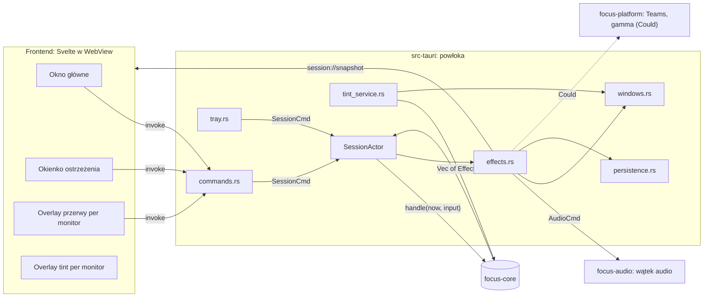
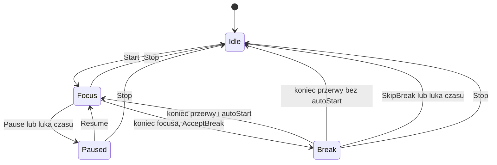

# FocusMode — Architektura

> Status: **wersja 3** — po dwóch cross-review ([2026-09-27](reviews/codex-crosscheck-2026-09-27.md), [2026-10-06](reviews/codex-review-2026-10-06.md); poprawki R01–R09).
> Decyzje: [DECISIONS.md](DECISIONS.md). Produkt i profil czasów: [DESIGN.md](DESIGN.md).
>
> **Uwaga (2026-10-13):** aktualny zakres to [ADR-013](DECISIONS.md#adr-013-speedrun-pivot-produktu) (speedrun). Aktualny jest §6 (kontrakt IPC, zgodny z `api.rs`).
> Pozostałe sekcje są sprzed pivotu (okna przerwy, ostrzeżenie, tryb spotkania, tint, muzyka w rodio). Tam, gdzie różnią się od ADR-013, wygrywa ADR-013 (task SR-09).

## 1. Stos technologiczny w skrócie

| Warstwa | Technologia | Po co |
|---|---|---|
| Powłoka / okna / tray | **Tauri 2** (Rust) | okna (także overlaye per monitor), tray, powiadomienia, instalatory — bez ręcznego HWND |
| Logika domenowa | **Rust**, crate `focus-core` | profil czasów, maszyna stanów, planer przerwy, walidacja configu, agregaty statystyk — czysta, bez I/O |
| Audio | **rodio** w `focus-audio` | odtwarzanie plików, generowany szum, fade |
| Integracje OS | `focus-platform` | (Could) Teams DND przez Graph, eksperymentalna gamma ramp |
| UI | **Svelte 5 + TypeScript + Vite** w WebView | szybki, ładny interfejs; animacje CSS |
| Typy UI↔Rust | **ts-rs** (`#[ts(export)]`) | typy TS generowane z DTO w Ruście |
| Build | `tauri build`, GitHub Actions | instalator Windows (NSIS/MSI) od M1; macOS/Linux w CI best-effort |

Platforma odbioru to Windows, pozostałe best-effort z tabelą ograniczeń (DESIGN §4, ADR-008).
Tauri nie gwarantuje identycznego UX na każdym OS; to, co obiecujemy, sprawdzamy testami na sprzęcie.

## 2. Układ repozytorium

```
.
├── Cargo.toml                 # workspace: crates/* + src-tauri
├── Cargo.lock                 # commitowany; CI buduje z --locked
├── rust-toolchain.toml        # przypięta wersja Rusta
├── .nvmrc                     # przypięta wersja Node
├── .cargo/config.toml         # [env] TS_RS_EXPORT_DIR = src/lib/bindings (relative = true)
├── assets/
│   ├── exercises.json         # JEDYNY katalog ćwiczeń (czyta powłoka → planer w core)
│   └── music/                 # genres.toml, pliki audio, CREDITS.md
├── crates/
│   ├── focus-core/            # ZERO zależności od Tauri/rodio/OS/sieci/systemu plików
│   │   └── src/
│   │       ├── api.rs         # DTO współdzielone z UI (#[ts(export)]) — KONTRAKT
│   │       ├── timing.rs      # TimingProfile { normal(), demo() } — jedyne źródło czasów
│   │       ├── clock.rs       # Now { mono, wall } — typy czasu (bez czytania zegara)
│   │       ├── session.rs     # maszyna stanów: Session::handle(now, Input) -> Vec<Effect>
│   │       ├── break_plan.rs  # planer przerwy: (katalog, profil, seed) -> BreakPlan
│   │       ├── config.rs      # Config + Default + walidacja + from/to TOML string (bez plików)
│   │       ├── stats.rs       # SessionRecord, agregaty dzienne, podsumowanie jednym zdaniem
│   │       └── tint.rs        # kelvin -> kolor/alfa overlay, harmonogram
│   ├── focus-audio/           # wątek audio (rodio), playlisty, generatory szumu, model fade
│   └── focus-platform/        # (Could) DndProvider/Teams, eksperymentalna gamma — za traitami
├── src-tauri/                 # powłoka (imperative shell)
│   ├── tauri.conf.json
│   ├── build.rs               # tauri_build + (Should) manifest komend aplikacji dla ACL
│   ├── capabilities/          # uprawnienia per typ okna
│   └── src/
│       ├── main.rs            # tylko focusmode_lib::run()
│       ├── lib.rs             # Builder, pluginy, setup, rejestracja komend       [B]
│       ├── commands.rs        # cienkie adaptery #[tauri::command] → SessionCmd   [B]
│       ├── session_actor.rs   # aktor: Session + tick + dispatch efektów          [A]
│       ├── effects.rs         # Effect → audio / okna / persystencja / eventy     [A]
│       ├── persistence.rs     # odczyt/zapis config.toml, sessions.jsonl, katalog [A]
│       ├── windows.rs         # main, warning, break-{n}, tint-{n} + bootstrap    [B]
│       ├── tray.rs                                                                [B]
│       └── tint_service.rs    # harmonogram → okna tint                           [A]
├── src/                       # FRONTEND: SvelteKit w trybie SPA (adapter-static, ssr=false) — nie Rust!
│   ├── app.html               # szablon SvelteKit; routing okien (#/break itd.): decyzja B — router hash SvelteKit lub własny
│   ├── lib/
│   │   ├── api.ts             # JEDYNE miejsce z invoke()/listen()
│   │   ├── bindings/          # GENEROWANE przez ts-rs — nie edytować
│   │   ├── stores/            # session store: snapshot + rewizje
│   │   ├── components/        # TimerRing, GenrePicker, ExerciseCard, HoldToSkip, ...
│   │   ├── illustrations/     # SVG/komponenty po id ćwiczenia + fallback
│   │   └── strings.ts         # teksty UI
│   └── routes/                # SvelteKit: +page.svelte (main), warning/, break/, tint/, settings/, stats/
└── docs/
```

## 3. Diagram komponentów



## 4. Wzorzec: functional core, imperative shell (ADR-002)

```rust
// crates/focus-core (szkic — nazwy do ustalenia w T0-4)
pub struct Now { pub mono: Duration /* od startu aplikacji, monotoniczny */, pub wall: OffsetDateTime /* lokalny kalendarz */ }

pub enum Input {
    Start { genre: GenreId },
    Pause, Resume, Stop,
    Tick,
    AcceptBreak,                          // „Idę” (tylko w ostrzeżeniu)
    Postpone,                             // „Jeszcze 2 min” (tylko w ostrzeżeniu, raz na cykl)
    SetMeetingMode { minutes: Option<u32> }, // None = wyłącz
    SkipBreak { break_id: BreakId },      // idempotentne, z ID konkretnej przerwy
    ConfigChanged(Config),
}

pub enum Effect {
    Audio(AudioCmd),                      // Play{genre}, Pause, Resume, FadeTo{factor, ms}, Stop, Gong
    ShowBreak { break_id: BreakId },      // plan jest w snapshocie, nie w efekcie
    HideBreak { break_id: BreakId },
    ShowWarning, HideWarning,
    Notify { title: String, body: String },   // tylko tekst
    RecordSession(SessionRecord),         // dokładnie raz na cykl; klucz (session_id, cycle)
    SetDnd { on: bool },                  // Could; to *docelowy stan*, uzgadnia go DndWorker (§7)
}

impl Session {
    pub fn new(profile: TimingProfile, catalog: ExerciseCatalog, seed: u64) -> Self;
    pub fn handle(&mut self, now: Now, input: Input) -> Vec<Effect>;
    pub fn snapshot(&self, now: Now) -> SessionSnapshot; // odtwarza CAŁY widok (§6.3)
}
```

Zasady:
- `focus-core` **nie czyta zegara, plików ani sieci**. `now`, katalog ćwiczeń i seed przychodzą z zewnątrz,
  więc testy są deterministyczne.
- Config w core to typy, `Default`, walidacja oraz `from_toml_str` / `to_toml_string`. **Pliki czyta i zapisuje powłoka** (`persistence.rs`).
- Wszystkie czasy pochodzą z `TimingProfile` (żadnych „magicznych” liczb w logice ani w UI; UI dostaje czasy w snapshocie).

## 5. Model czasu i maszyna stanów (ADR-011)

### 5.1 Profil czasów

| Parametr | `normal()` | `demo()` |
|---|---:|---:|
| `focus_secs` (ostrzeżenie się w nim zawiera) | 2400 | 40 |
| `warning_secs` | 30 | 5 |
| `break_secs` | 300 | 20 |
| `postpone_secs` (raz na cykl) | 120 | 10 |
| `meeting_options` | 15/30/60 min | 15 s |
| `interruption_gap_secs` | 60 | 60 |
| `min_walk_secs` (minimalny `stand-walk` na końcu przerwy) | 30 | 10 |

Długości faz z configu użytkownika nadpisują `normal()`. Demo ignoruje config i używa stałego planu przerwy.

**Walidacja configu** (core, `Config::validate`, R09): `focus_secs` ∈ [300, 7200], `break_secs` ∈ [60, 1800],
`warning_secs` < `focus_secs`, `postpone_secs` ∈ [60, 600]. Wartości spoza zakresu dają `AppError` z polem, a nie cichą korektę.
Arytmetyka czasu tylko `checked_*`/`saturating_*` (bez ujemnych reszt na `u32`).

**Planer przerwy** (`break_plan.rs`, R09): z przetasowanego (seed) katalogu bierze **co najwyżej 2** ćwiczenia, ale tylko takie,
dla których `suma + min_walk_secs ≤ break_secs`. Resztę wypełnia `stand-walk`. Przy krótkiej przerwie wychodzi 0–1 ćwiczenie + spacer.
Czasów ćwiczeń nie skracamy w trybie normalnym. Suma planu zawsze = `break_secs`.

### 5.2 Zegary
- **Fazy i deadline'y**: `now.mono` (monotoniczny). **Statystyki dzienne i harmonogram tint**: `now.wall`.
- **Heurystyka przerwania**: jeśli między tickami minęło > `interruption_gap_secs` w zegarze monotonicznym **albo**
  zegar kalendarzowy przeskoczył o tyle więcej niż monotoniczny, to sesja jest przerwana. Tak łapiemy uśpienie niezależnie od tego,
  czy dany OS wlicza suspend do `Instant`; fałszywym alarmem będzie np. ręczna zmiana zegara. Skutki:
  - w Focus → `Paused { reason: Interrupted }`, czeka na Resume; luka **nie** liczy się jako czas focusa,
  - w Break → Idle, wynik przerwy `interrupted` (nie zaliczamy ćwiczeń automatycznie).
- **Pauza zamraża pozostały czas, a nie przesuwa deadline'u** (R05). `Paused { remaining_secs }`; Resume ustawia `deadline = now + remaining`.
  - Pause użytkownika: `remaining = deadline − now`.
  - Przerwanie (luka): `remaining = deadline − last_trusted_tick`, czyli czas od ostatniego zaufanego ticka do wykrycia luki **nie** jest zużywany.
  - Przykład: deadline 40 s, ostatni zaufany tick 10 s, wykrycie 130 s, Resume 135 s → nowy deadline 165 s (30 s focusa zostaje, aktywny czas = 10 s).
- Czas aktywnej sesji = suma odcinków, w których Focus faktycznie biegł (do ostatniego zaufanego ticka; bez pauz i luk).
- Tryb spotkania: `meeting_until` (zegar monotoniczny). `meeting_active = meeting_until > now`.

### 5.3 Stany



Ostrzeżenie **nie jest osobną fazą**, tylko flagą `warning` w Focus (ostatnie `warning_secs`).
Tryb spotkania to pole `meeting_until` w Focus/Paused.

**Reguła spotkania (R01), wspólna dla wszystkich przejść:** dopóki `meeting_active`, **nie zaczyna się ani ostrzeżenie, ani przerwa**.
Włączenie spotkania w trakcie ostrzeżenia zeruje `warning`. Gdy spotkanie się kończy (wygaśnięcie albo `SetMeetingMode(None)`)
i do deadline'u zostało mniej niż `warning_secs` (albo deadline już minął), ustawiamy `deadline = now + warning_secs`
i od razu startuje **pełne** ostrzeżenie. „Idę” (AcceptBreak) działa tylko w ostrzeżeniu, więc w trakcie spotkania przerwy nie da się wymusić:
najpierw trzeba zakończyć spotkanie.

### 5.4 Pełna tabela: faza × wejście

`–` = ignorowane (no-op, bez błędu). Każde wejście jest idempotentne. „spotk.” = `meeting_active`.

| Faza \ wejście | Start | Pause | Resume | Stop | AcceptBreak | Postpone | SetMeetingMode | SkipBreak{id} | Tick |
|---|---|---|---|---|---|---|---|---|---|
| **Idle** | → Focus | – | – | – | – | – | – | – | – |
| **Focus** | – | → Paused(User, remaining) | – | → Idle, record(`stopped`) | – | – | ustaw / wyłącz (przy wyłączeniu: reguła spotkania) | – | spotk. → nic (przerwa czeka); koniec spotk. → reguła spotkania; bez spotk.: T−warn → `warning=true`, T → Break; luka → Paused(Interrupted) |
| **Focus + warning** | – | → Paused(User, remaining), `warning=false` | – | → Idle, record(`stopped`) | → Break | `deadline += postpone_secs`, `warning=false`, raz na cykl | ustaw → `warning=false` | – | T → Break (spotk. tu nie występuje); luka → Paused(Interrupted) |
| **Paused** | – | – | → Focus, `deadline = now + remaining`; jeśli bez spotk. i `remaining ≤ warning_secs` → `warning=true` | → Idle, record(`stopped`) | – | – | ustaw / wyłącz | – | nic (czas stoi) |
| **Break** | – | – | – | → Idle, record(`stopped`) | – | – | – | id zgodne → Idle, record(`skipped`); inne → – | koniec: autoStart ? → Focus : → Idle, record(`completed`); luka → Idle, record(`interrupted`) |

Efekty przejść:

| Przejście | Efekty |
|---|---|
| Idle → Focus | `Audio(Play)` z fade-in; (Could) `SetDnd{on}` |
| wejście w ostrzeżenie (także po końcu spotkania i po Resume) | `ShowWarning`, `Notify` (tekst), `Audio(FadeTo{0.3})` |
| wyjście z ostrzeżenia bez przerwy (Postpone / włączenie spotkania) | `HideWarning`, `Audio(FadeTo{1.0})` |
| Focus → Paused (User lub Interrupted) | `Audio(Pause)`, `HideWarning` (jeśli było) |
| Paused → Focus | `Audio(Resume)` (fade 1.0), a jeśli od razu ostrzeżenie: efekty wejścia w ostrzeżenie |
| Focus → Break | `HideWarning`, `ShowBreak{id}`, `Audio(FadeTo{0})`, `Audio(Gong)`; (Could) `SetDnd{off}` |
| zmiana ćwiczenia w Break | `Audio(Gong)` |
| Break → Focus | `HideBreak{id}`, `RecordSession`, `Audio(Play)`; (Could) `SetDnd{on}` |
| * → Idle | `Audio(Stop)`, `HideWarning`, `HideBreak`, `RecordSession` (jeśli był cykl), (Could) `SetDnd{off}` |

`RecordSession` zapisuje **dokładnie jeden** rekord na cykl (`session_id` + `cycle`), z wynikiem:
`completed | skipped | stopped | interrupted`.

### 5.5 Testy obowiązkowe (A-01)
Granice demo 34/35/39/40/60 s; Postpone raz (drugi ignorowany) i po nim ponowne ostrzeżenie; Stop w każdej fazie i Stop dwukrotny;
SkipBreak z cudzym `break_id`; luka w Focus i w Break; dokładnie jeden `RecordSession` na cykl; aktywny czas bez pauz.
**Spotkanie (R01):** włączone przed ostrzeżeniem i w trakcie ostrzeżenia (demo: spotkanie w 30 s na 15 s → brak przerwy w 40 s,
pełne ostrzeżenie 45–50 s, przerwa w 50 s); wygaśnięcie i ręczne wyłączenie po deadline; AcceptBreak w trakcie spotkania ignorowany.
**Pauza (R05):** oś z przykładu w §5.2 daje 30 s do przerwy i 10 s aktywnego focusa; Pause w ostrzeżeniu chowa okienko ostrzeżenia,
a Resume z `remaining ≤ warning_secs` pokazuje je ponownie.
**Planer i config (R09):** przerwa krótsza od, równa i dłuższa od sumy ćwiczeń + `min_walk_secs`; suma planu = `break_secs`, bez ujemnej reszty;
config spoza zakresów → błąd walidacji.

## 6. Kontrakt IPC (UI ↔ Rust) (ADR-006, ADR-012, ADR-013)

> Stan na 2026-10-13, zgodny z `crates/focus-core/src/api.rs`. Przy rozbieżności wygrywa `api.rs`.

DTO w `crates/focus-core/src/api.rs`: `#[derive(Serialize, Deserialize, TS)]`, **`#[ts(export)]`**,
`#[serde(rename_all = "camelCase")]`. Liczby jako `u32` (unikamy `bigint` w TS); wyjątek to znaczniki czasu `startedAtMs` / `endedAtMs`
(`i64` eksportowane jako `number`).
Eksport: `cargo test -p focus-core` zapisuje do `TS_RS_EXPORT_DIR` (ustawione w `.cargo/config.toml` względem workspace).
**CI sprawdza, czy po regeneracji `src/lib/bindings/` nie ma zmian** (`git diff --exit-code`).
Nazwy komend i eventów są stałymi w `api.rs` (`commands::*`, `events::*`), które test `export_names` zapisuje do `src/lib/bindings/names.ts`
(`COMMANDS`, `EVENTS`, `BRIDGE_PORT`), więc `api.ts` nie wpisuje ich ręcznie. Zmiany kontraktu przechodzą przez skill `/sync-contract`.

### 6.1 Komendy

Cienkie adaptery w `src-tauri/src/commands.rs`; logika w aktorze sesji, w wykonawcach efektów i w core.
Każda komenda zwraca `Result<T, AppError>`, gdzie `AppError { code, message, field }`: `code` to stabilny kod (`config.invalid`, `audio.device`,
`shields.notifications`, `teams.auth`, `media.url`…), `message` to szczegół po angielsku do logów (UI mapuje `code` na polski tekst),
a `field` to pole configu, które nie przeszło walidacji (`focusMinutes`, `music.volume`…). Argumenty `invoke` są w camelCase.

| Komenda | Argumenty | Zwraca | Uwagi |
|---|---|---|---|
| `get_snapshot` | – | `SessionSnapshot` | |
| `start_session` | – | `()` | sesja z bieżącym configiem (albo z profilem demo) |
| `pause_session` | – | `()` | zamraża pozostały czas bieżącej fazy (Focus albo Przerwa) |
| `resume_session` | – | `()` | |
| `stop_session` | – | `()` | idempotentna, działa w każdej fazie |
| `skip_phase` | – | `()` | Focus → Przerwa od razu, Przerwa → następny Focus od razu |
| `get_config` | – | `Config` | |
| `update_config` | `config: Config` | `Config` | znormalizowany, zwalidowany i zapisany |
| `list_folder_tracks` | `path: string` | `Track[]` | skan folderu; znalezione pliki audio trafiają do scope asset protocol |
| `get_shield_status` | – | `ShieldStatus` | |
| `get_current_usage` | – | `UsageReport` | użycie aplikacji w trwającej sesji (puste w Idle) |
| `get_last_summary` | – | `SessionSummary \| null` | |
| `list_history` | `limit: number` | `SessionSummary[]` | od najnowszej |
| `get_teams_status` | – | `TeamsStatus` | |
| `teams_connect` | – | `DeviceCodePrompt` | start logowania device code; postęp przychodzi jako `teams://status` |
| `teams_disconnect` | – | `()` | zapomina zapisany token |
| `get_bridge_info` | – | `BridgeInfo` | port mostu, folder rozszerzenia, kiedy rozszerzenie ostatnio pytało |
| `open_extension_dir` | – | `()` | otwiera folder dołączonego rozszerzenia w menedżerze plików |
| `test_chime` | `chime: ChimeKind` | `()` | dzwonek z głośnością dzwonków z configu |
| `open_media_window` | `url: string, play: boolean` | `()` | otwiera (albo przekierowuje) osobne okno YouTube, które gra link jako stronę najwyższego poziomu. Dla linków odmawiających osadzania (błędy YouTube 101/150/153) albo takich, których nie da się osadzić (ADR-013 pkt 2). Tylko https YouTube / YouTube Music, inaczej `media.url` |
| `control_media_window` | `action: MediaAction, volume: number \| null` | `()` | `MediaAction`: `play` / `pause` / `setVolume` / `show` (pokazuje, przywraca i aktywuje okno, np. do akceptacji strony zgody YouTube) / `close`. `volume` (0..1) tylko dla `setVolume`. Przy zamkniętym oknie no-op |
| `get_media_window` | – | `MediaWindowStatus` | |
| `get_blocklist` | – | `BlocklistInfo` | wczytana lista `websiteblacklist.txt` (przy pierwszym starcie plik powstaje z domyślnej listy wbudowanej w aplikację) |
| `open_blocklist_file` | – | `()` | otwiera `websiteblacklist.txt` w domyślnym edytorze tekstu systemu |
| `reload_blocklist` | – | `BlocklistInfo` | wczytuje plik od razu (po zapisaniu i tak wczytuje się sam) |

Most dla rozszerzenia nie jest komendą Tauri: `GET http://127.0.0.1:47615/v1/state` → `BridgeState { active, blocklist, patterns, phase, remainingSecs }`
(port to stała `BRIDGE_PORT` w `api.rs`). `blocklist` to znormalizowane domeny (każda blokuje też swoje subdomeny), a `patterns` to źródła
wyrażeń regularnych (RE2) dopasowywanych do pełnego adresu URL bez rozróżniania wielkości liter. Poza blokadą obie listy są puste.
`patterns` ma `#[serde(default)]`, więc stan bez tego pola też się wczytuje.

### 6.2 Eventy

Emituje tylko powłoka; nazwy `obszar://nazwa`.

| Event | Payload | Kiedy |
|---|---|---|
| `session://snapshot` | `SessionSnapshot` | co tick (1 s) i po każdej zmianie |
| `session://phase-changed` | `PhaseChange { from, to, cycle }` | przy każdym przejściu fazy |
| `session://summary` | `SessionSummary` | raz, gdy sesja się kończy (Stop) |
| `shields://status` | `ShieldStatus` | gdy któraś osłona zmienia stan |
| `teams://status` | `TeamsStatus` | gdy zmienia się połączenie z Teams (także postęp logowania) |
| `focus://nudge` | `Nudge` | awaryjny nudge: tracker wykrył stronę z listy w tytule okna przeglądarki (bez rozszerzenia); `matched` to domena albo źródło regexu |
| `app://error` | `AppError` | integracja zawiodła; sesja trwa (degradacja) |
| `media://window` | `MediaWindowStatus` | okno YouTube się otwiera, zamyka, przechodzi na inny adres albo zmienia tytuł |
| `blocklist://changed` | `BlocklistInfo` | `websiteblacklist.txt` wczytany ponownie (automatycznie albo przez `reload_blocklist`) z innym wynikiem |

**Każdy stan widoku ma parę getter + event z rewizją** (ADR-012, R06):

| Stan | Getter | Event |
|---|---|---|
| `SessionSnapshot` | `get_snapshot` | `session://snapshot` |
| `ShieldStatus` | `get_shield_status` | `shields://status` |
| `TeamsStatus` | `get_teams_status` | `teams://status` |
| `MediaWindowStatus` | `get_media_window` | `media://window` |
| `BlocklistInfo` | `get_blocklist` (także wynik `reload_blocklist`) | `blocklist://changed` |

Pole `revision` ustawia powłoka i rośnie z każdym wysłanym stanem. UI, dla każdego z tych stanów:
1. **najpierw** rejestruje `listen(...)`,
2. potem wywołuje getter,
3. stosuje dane tylko wtedy, gdy `revision` jest większa od już posiadanej (chroni przed starszą odpowiedzią gettera).

`session://phase-changed`, `session://summary`, `focus://nudge` i `app://error` to zdarzenia jednorazowe, bez rewizji
(ostatnie podsumowanie da się też pobrać przez `get_last_summary`).

### 6.3 Snapshot sesji i okna

```rust
pub struct SessionSnapshot {
    pub revision: u32,              // ustawia powłoka; rośnie z każdym wysłanym snapshotem
    pub session_id: Option<String>,
    pub phase: Phase,               // Idle | Focus | Break
    pub paused: bool,               // pauza użytkownika albo automatyczna po luce zegara; ma sens tylko w Focus/Break
    pub cycle: u32,                 // numer bieżącego cyklu skupienia od 1 (0 w Idle)
    pub remaining_secs: u32,        // pozostało w bieżącej fazie (zamrożone w pauzie)
    pub phase_total_secs: u32,      // długość bieżącej fazy (0 w Idle)
    pub focus_secs: u32,            // profil w użyciu (z configu albo demo)
    pub break_secs: u32,
    pub focused_secs: u32,          // czas skupienia faktycznie spędzony w tej sesji (bez pauz i luk)
    pub demo: bool,                 // profil demo (`--demo` / `FOCUSMODE_DEMO=1`)
}
```

| Okno | Zawartość | Uprawnienia IPC |
|---|---|---|
| `main` | SPA (Skupienie / Podsumowanie / Ustawienia) + odtwarzacz muzyki w layoucie; zamknięcie = ukrycie | wszystkie komendy (capability `default`) |
| `media` | strona YouTube / YouTube Music jako strona najwyższego poziomu (fallback, ADR-013 pkt 2) | **żadnych**: powłoka steruje nim przez `eval` wstrzykniętego kontrolera, a stan wraca do UI jako `media://window` |

Okien przerwy, ostrzeżenia i `tint-*` nie ma (ADR-013), więc odpadają `window_ready`, heartbeat, watchdog i `break_id`.

### 6.4 Przykłady JSON

`SessionSnapshot` (demo, przerwa po pierwszym cyklu):

```json
{ "revision": 42, "sessionId": "1760350000000-12345-1", "phase": "break", "paused": false, "cycle": 1,
  "remainingSecs": 12, "phaseTotalSecs": 20, "focusSecs": 40, "breakSecs": 20, "focusedSecs": 40, "demo": true }
```

`ShieldStatus` (Focus, Teams wyłączone w ustawieniach):

```json
{ "revision": 7, "active": true,
  "notifications": { "state": "on", "detail": null },
  "teams": { "state": "off", "detail": null },
  "sites": { "state": "on", "detail": null },
  "keepAwake": { "state": "on", "detail": null },
  "extensionConnected": true }
```

`MediaWindowStatus` (okno YouTube z domyślnym streamem):

```json
{ "revision": 3, "open": true, "url": "https://www.youtube.com/@LofiGirl/live",
  "title": "lofi hip hop radio - beats to relax/study to" }
```

Argumenty komend okna YouTube: `open_media_window` → `{ "url": "https://www.youtube.com/@LofiGirl/live", "play": true }`,
`control_media_window` → `{ "action": "setVolume", "volume": 0.4 }` albo `{ "action": "pause", "volume": null }`.

`AppError` (walidacja configu):

```json
{ "code": "config.invalid", "message": "focusMinutes must be between 1 and 240, got 300", "field": "focusMinutes" }
```

`BlocklistInfo` (plik z jedną pominiętą linią; listy skrócone, `message` przykładowy):

```json
{ "revision": 2, "path": "C:\\Users\\ola\\AppData\\Roaming\\com.focusmode.app\\websiteblacklist.txt",
  "domains": ["kwejk.pl", "jbzd.com.pl", "reddit.com"],
  "patterns": ["linkedin\\.com/feed", "youtube\\.com/shorts"],
  "issues": [{ "line": 42, "text": "(reddit|wykop\\.pl", "message": "Niepoprawne wyrażenie regularne: brak zamykającego nawiasu." }],
  "error": null }
```

`BridgeState` (Focus, blokada włączona):

```json
{ "active": true, "blocklist": ["kwejk.pl", "reddit.com"], "patterns": ["youtube\\.com/shorts"],
  "phase": "focus", "remainingSecs": 1712 }
```

### 6.5 Lista blokowanych stron (`websiteblacklist.txt`, ADR-013 pkt 4)

Lista stron do blokowania nie jest częścią `Config`: **jedynym źródłem jest plik `websiteblacklist.txt`** w katalogu konfiguracji
(`app_config_dir()`, na Windows `%APPDATA%\com.focusmode.app\websiteblacklist.txt`). Pole `shields.blocklist` usunięto z `ShieldsConfig`.
Zostaje włącznik `shields.blockSites`. Stary `config.json` z polem `shields.blocklist` nadal się wczytuje, a to pole jest ignorowane.

- `BlocklistInfo { revision, path, domains, patterns, issues, error }`: `path` to bezwzględna ścieżka pliku, `domains` to znormalizowane domeny
  (zwykłe linie), a `patterns` to źródła regexów (linie w `/…/` albo ze znakami regexu). Obie listy zachowują kolejność z pliku, bez duplikatów.
  `issues` to pominięte linie, a `error` jest ustawiony, gdy pliku nie da się przeczytać; wtedy w użyciu zostaje poprzednia lista (albo domyślna).
- `BlocklistIssue { line, text, message }`: numer linii (od 1), linia jak w pliku (przycięta, najwyżej 200 znaków) i polski opis
  dla Ustawień (niepoprawna domena, niepoprawny albo zbyt złożony regex, przekroczony limit).
- Parsowanie i walidacja to czysta funkcja w `focus-core` (`blocklist.rs`, crate `regex`). Plik tworzy, czyta i przeładowuje powłoka
  (`src-tauri/src/blocklist.rs`): przy starcie, automatycznie po zapisaniu i przez `reload_blocklist`. Domyślna treść
  (`crates/focus-core/assets/websiteblacklist.txt`) jest wbudowana w aplikację, a przy braku pliku zostaje do niego skopiowana.
- Dopasowanie: domena blokuje siebie i swoje subdomeny. Regex jest dopasowywany bez rozróżniania wielkości liter: w rozszerzeniu
  do pełnego adresu URL karty, a w awaryjnym nudge'u trackera do tytułu okna przeglądarki.

## 7. Model wątków i współbieżności

```
Wątek główny (event loop Tauri)  ── okna, tray, WebView
Runtime tokio (tauri::async_runtime)
 ├── SessionActor: select! { cmd = rx.recv(), _ = interval(1 s).tick(), res = effect_results.recv() }
 │     → Session::handle → dispatch efektów (bez await na wolnych operacjach)
 ├── TintService: interval(60 s) → core::tint → okna tint
 ├── BreakWatchdog: heartbeaty okien przerwy (§6.3)
 ├── PersistenceWorker: jedna kolejka, zapisy po kolei (config, sessions.jsonl)
 └── DndWorker (Could): uzgadnia docelowy stan DND z Graph, po kolei
Wątek audio (std::thread)
 └── MixerDeviceSink + Player (rodio 0.22); AudioCmd przez kanał; AudioEvent z powrotem;
     błędy urządzenia z wątku cpal → kanał → ponowne otwarcie urządzenia domyślnego
```

- **Aktor nigdy nie czeka na wolny efekt.** Efekty trafiają do kolejek wykonawców (kanał, `send` bez czekania), więc Stop jest obsługiwany natychmiast.
- **Ignorowanie spóźnionego wyniku nie anuluje efektu** (R02). Rozpoczętego `spawn_blocking` nie da się przerwać `abort`em,
  a wysłanego żądania HTTP nie da się cofnąć. Dlatego kolejność i poprawność efektów zapewniają **wykonawcy**, a nie filtr w aktorze:
  - **Jeden wykonawca na zasób, operacje seryjnie** w kolejności zlecenia. Dwa zapisy configu nie mogą skończyć się w odwrotnej kolejności.
  - **Docelowy stan zamiast poleceń** tam, gdzie efekt jest zewnętrzny (DND): `SetDnd{on}` ustawia `desired` + numer generacji.
    DndWorker po zakończeniu każdego wywołania sprawdza, czy `desired` się nie zmieniło. Jeśli tak, wykonuje kolejne wywołanie dla aktualnego stanu.
    Timeout oznacza „stan nieznany” i wymusza ponowne uzgodnienie, a nie „anulowane”.
  - **`RecordSession` to trwałe zlecenie:** nie jest odrzucane dlatego, że sesja się skończyła. Klucz `(session_id, cycle)` jest unikalny,
    a PersistenceWorker pomija duplikat przy ponowieniu (zbiór kluczy wczytany przy starcie z `sessions.jsonl`).
  - Okna (`ShowBreak`/`HideBreak`, ostrzeżenie) wykonuje się w kolejności na wątku głównym (`run_on_main_thread`), a operacje niosą `break_id`.
- Wyniki od wykonawców wracają do aktora z `op_id`/generacją i służą **tylko** do aktualizacji stanu w UI (np. „Teams: DND aktywne”).
  Spóźniony wynik nie zmienia stanu aktora.
- Stan dla UI: jeden właściciel (aktor), snapshot przez event i `get_snapshot`. Nie ma `Arc<Mutex<Session>>` wołanego z wielu miejsc.

## 8. Audio (`focus-audio`) (ADR-003)

Ustalenia ze spike'a T0-10 (kod referencyjny: [spikes/audio-spike](../spikes/audio-spike/src/main.rs)):

- **Wersja: `rodio = { version = "=0.22.2", features = ["noise"] }`** (cpal 0.17, backend WASAPI na Windows).
  W spike'u dodatkowo `wav_output`, tylko do wygenerowania pliku testowego.
- **API rodio 0.22** (inne niż w starszych tutorialach, gdzie było `OutputStream` / `Sink`):
  - urządzenie: `DeviceSinkBuilder::from_default_device()?.with_error_callback(..).open_sink_or_fallback()?` → `MixerDeviceSink`
    (odtwarzanie trwa, dopóki ten obiekt żyje; `log_on_drop(false)` wycisza komunikat przy drop),
  - odtwarzacz: `Player::connect_new(sink.mixer())`, a potem `append`, `set_volume`, `pause`/`play`, `stop`,
  - `Source` to `Iterator<Item = Sample>` (`f32`), a `channels()` / `sample_rate()` zwracają `NonZero` (`ChannelCount`, `SampleRate`),
  - dekodowanie: `Decoder::try_from(File)` (symphonia: mp3/ogg/flac/wav/mp4 w domyślnych feature'ach).
- `MixerDeviceSink` i `Player` są **`Send + Sync`** na Windows (sprawdzone kompilacją). Dedykowany wątek zostaje jako
  **decyzja organizacyjna**: jeden właściciel urządzenia, prosty cykl życia i ponowne otwieranie urządzenia po błędzie.
- API: `AudioHandle::spawn(assets_dir) -> (AudioHandle, Receiver<AudioEvent>)`; `AudioCmd`: `Play{genre}`, `Pause`, `Resume`,
  `Stop`, `SetVolume(f32)`, `FadeTo{factor, ms}`, `Gong`, `Next`.
- **Docelowy stan odtwarzania (R04)**: wątek audio trzyma stan niezależny od tego, czy urządzenie istnieje:
  `desired: Stopped | Playing{genre} | Paused{genre}`, głośność użytkownika, bieżący i docelowy współczynnik fade oraz numer generacji.
  Komendy (`Play`/`Pause`/`Resume`/`Stop`/`SetVolume`/`FadeTo`) **zawsze** aktualizują ten stan, także gdy urządzenia nie ma.
  Reconnect **odtwarza** ten stan i nie jest nowym `Play`: przy `Stopped` tylko otwiera urządzenie, przy `Paused` tworzy odtwarzacz w pauzie,
  przy `Playing` gra z bieżącą głośnością × fade, a fade z przerwy nie jest resetowany. Ponawianie (co 2 s) nie blokuje odbierania komend.
- **Model głośności**: `efektywna = głośność_użytkownika × współczynnik_fade`, ustawiane przez `Player::set_volume`.
  `Resume` i `Play` przywracają fade do 1.0, więc po Postpone muzyka nie zostaje wyciszona. Pętla wątku robi `recv_timeout(20 ms)` i w każdym obiegu
  przesuwa fade. **Stop w trakcie 10-sekundowego fade'u jest obsłużony od razu** (zmierzone: < 20 ms opóźnienia pętli + ~2 µs sam Stop).
- Gatunki w `assets/music/genres.toml`: `kind = "noise"` (`brown | pink | white`) albo `"files"` (katalog; shuffle + pętla). M1: brown noise + 1 utwór CC0.
- **Szum**: rodio ma wbudowane `source::noise::{white, pink}` (feature `noise`) i ich używamy. **Brown noise rodio nie ma**,
  więc mamy własny `Source`: biały szum z rodio, całkowany z wyciekiem (`last = (last + 0.02·w) / 1.02`, wyjście ×3.5, clamp do [-1, 1]).
- **Błędy urządzenia**: callback z `with_error_callback` działa na wątku cpal, więc tylko przekazuje błąd kanałem do wątku audio.
  Wątek audio porzuca `Player` i `MixerDeviceSink`, co 2 s próbuje otworzyć **aktualne** urządzenie domyślne, a po sukcesie odtwarza
  docelowy stan (wyżej) i wysyła `AudioEvent::Reconnected`. Spike grał wtedy od nowa; w `focus-audio` obowiązuje reguła docelowego stanu. Sesja trwa dalej, a UI pokazuje „brak dźwięku” do czasu ponownego połączenia. rodio samo się nie łączy ponownie.
  **Sprawdzone (Windows 10, WASAPI):** wyłączenie urządzenia w `mmsys.cpl` → błąd „device is no longer available” w callbacku; potem „Could not find any output device” przy każdej próbie (brak urządzenia nie crashuje); po ponownym włączeniu szum wraca w ≤ 2 s.
- **Stabilność czasowa (40 min): niepotwierdzona na prawdziwym sprzęcie.** Spike działał w VirtualBoxie z emulowaną kartą HDA.
  40 min bez crasha i bez wycieku, ale emulowany zegar audio pływa: urządzenie pobierało od 0,75× do 1,3× nominalnego tempa,
  także w surowym cpal bez rodio, co wskazuje na środowisko (emulowana karta), a nie na rodio. Rozstrzygnie to dopiero pomiar na sprzęcie. Wątek callbacku działał regularnie (~20 ms), z 2 pauzami ~180 ms na 5 min.
  **Na VM nie mierzymy czasu audio ani okien.** Powtórka na fizycznym Windows: `audio-spike rawcpal 60` (oczekiwane ratio ≈ 1,000)
  i `audio-spike diag 2400 60` (metronom + pauzy callbacku); przy pauzach > 100 ms porównać z wariantem `--features boost`
  (MMCSS przez feature cpal `audio_thread_priority` + wyłączenie power throttlingu procesu) — task T0-11.
- Brak pliku / błąd dekodowania → `AudioEvent::Error`, bez crasha (sprawdzone).
- Zasoby dołączane przez `bundle.resources`; ścieżkę rozwiązuje powłoka (`BaseDirectory::Resource`).

## 9. Tint i integracje

### 9.1 Tint: overlay jako główny mechanizm (ADR-009)
- Okna `tint-{n}` na każdym monitorze: przezroczyste, bez dekoracji, `always_on_top`, `skip_taskbar`, nieaktywujące się,
  `set_ignore_cursor_events(true)`. Kolor i alfa z `core::tint` (kelvin → RGBA).
- To **efekt wizualny**, nie kalibracja barw: obniża kontrast i tak go opisujemy.
- Znika razem z procesem, więc kolory wracają same po każdym crashu i kill.
- Harmonogram: godziny od–do + przejście 30 min + siła; podgląd w ustawieniach (`preview_tint`).
- macOS wymaga `macos-private-api` do przezroczystości; Wayland nie ma always-on-top, więc tam tint jest niedostępny i UI to komunikuje.

### 9.2 Eksperymentalna gamma ramp (Could, S-02)
- Tylko Windows, SDR, domyślnie wyłączona, poza ścieżką demo. Microsoft odradza `SetDeviceGammaRamp`: może zwrócić sukces
  bez efektu, zachowanie przy HDR jest niezdefiniowane, a system lub inne aplikacje mogą ją nadpisać.
- Sprzątanie opisujemy osobno dla każdego przypadku: **zwykłe wyjście**, **panika**, **zabicie procesu**.
- **Liniowa rampa to nie przywrócenie stanu** (R08): jeśli monitor miał własną kalibrację, reset do liniowej jej nie odtworzy,
  a po zmianie układu monitorów można zmienić niewłaściwy ekran. Poprawna wersja wymaga kopii bazowej rampy per monitor
  (`GetDeviceGammaRamp`, klucz = identyfikator urządzenia) zapisanej przed pierwszą zmianą oraz polityki konfliktu ze zmianami systemowymi po crashu.
- **Rekomendacja: nie wdrażać S-02 na hackathonie.** Overlay (§9.1) w pełni pokrywa funkcję.
  Weryfikacja ewentualnego eksperymentu: start z nieliniową rampą, zwykłe wyjście, kill + restart, zmiana monitora; patrzymy na wierność kalibracji, a nie na to, że „nie jest już pomarańczowo”.

### 9.3 Teams DND (Could, S-01, ADR-010)
- `Presence.ReadWrite` (delegowane), device code flow (public client), token w keychainie (`keyring`).
- Ustawienie: `POST /users/{id}/presence/setUserPreferredPresence` (`/me/...` sprawdzić w próbie),
  `{"availability":"DoNotDisturb","activity":"DoNotDisturb","expirationDuration":"PT10M"}`.
- **Bez automatycznego czyszczenia (R07).** `clearUserPreferredPresence` kasuje *każdy* preferowany status, a flaga „to my ustawiliśmy DND”
  nie dowodzi, że aktualny status nadal jest nasz (użytkownik mógł w międzyczasie ustawić np. „Zaraz wracam”). Odczyt przed czyszczeniem nie jest atomowy.
  Dlatego:
  - DND ustawiamy z **krótkim wygaśnięciem (10 min)** i odnawiamy co 5 min, tylko dopóki trwa Focus z włączoną integracją,
  - Stop, Pause i przerwa **przestają odnawiać** status, więc DND wygasa samo najpóźniej po 10 min,
  - UI ma przycisk „Wyczyść status Teams teraz” jako świadomą decyzję użytkownika, nigdy automatycznie.
- Preferred presence wymaga aktywnej sesji presence (zalogowany klient Teams). Zmiana ikony może trwać kilka minut, więc **w demo nie pokazujemy jej na żywo**.
- **Nie wykrywamy rozmów przez Graph** — od tego jest ręczny tryb spotkania.

## 10. Okna

| Etykieta | URL | Cechy |
|---|---|---|
| `main` | `index.html#/` | zwykłe okno; zamknięcie = hide (tray) |
| `warning` | `index.html#/warning` | małe, w rogu głównego monitora, always-on-top, nieaktywujące się, bez paska zadań |
| `break-{n}` | `index.html#/break?primary=1` | per monitor: tworzone ukryte → `window_ready` → pokazane; fullscreen, always-on-top, bez dekoracji; heartbeat co 1 s |
| `tint-{n}` | `index.html#/tint` | per monitor: przezroczyste, klikalne na wylot, bez fokusu; **tylko odczyt** (`get_tint_state`, `window_ready`) |

- Monitory: `app.available_monitors()`. Testujemy 2 monitory, różne DPI, monitor po lewej (ujemne współrzędne),
  odłączenie monitora w trakcie i aplikację fullscreen w tle. **Nie obiecujemy przykrycia elementów systemu** (np. paska zadań).
- Klawiatura: przytrzymanie Esc przez 3 s w oknie przerwy = `skip_break`. W trakcie przerwy tray ma zawsze aktywne „Pomiń przerwę” i „Stop”,
  niezależnie od stanu WebView (§6.3).
- **Uprawnienia**: własne komendy z `invoke_handler` są domyślnie dostępne **każdemu** oknu. Samo capabilities dla pluginów ich nie ogranicza.
  Izolację (Should, B-12) włączamy przez manifest komend aplikacji w `build.rs` oraz capabilities per etykieta okna,
  według tabeli w §6.3. Weryfikacja: `stop` wywołane z `tint-*` jest odrzucane przez backend, a `get_tint_state` z `tint-*` działa.
- Pluginy: `notification` (tylko tekst; przyciski akcji w tym pluginie są tylko na mobile), `single-instance`, `log`;
  (Could) `global-shortcut`, `autostart`.

## 11. Dane i konfiguracja

| Co | Gdzie | Kto czyta/pisze |
|---|---|---|
| Ustawienia | `app_config_dir()/config.toml` | `persistence.rs` (zapis atomowy: tmp + rename); core parsuje i waliduje string |
| Historia sesji | `app_data_dir()/sessions.jsonl` | `persistence.rs`, append-only, jeden `SessionRecord` na cykl |
| Katalog ćwiczeń | zasób `assets/exercises.json` | `persistence.rs` → `ExerciseCatalog` → core |
| Znacznik gammy (Could) | `app_data_dir()/gamma.active` | tylko dla S-02 |
| Token Teams (Could) | systemowy keychain | `keyring` |
| Logi | `app_log_dir()` | `tauri-plugin-log` / `tracing` |

Brak pliku oznacza ustawienia domyślne. Uszkodzony config: log + domyślne, a stary plik zostaje przemianowany na `.bak`. Błąd zapisu kończy się `app://error`, a sesja trwa dalej.
Demo nie zapisuje się do prawdziwej historii (rekordy z `demo: true` są pomijane w statystykach).

## 12. Obsługa błędów i logowanie

- Biblioteki: `thiserror`. Powłoka: `anyhow` wewnętrznie, `AppError { code, message }` na granicy IPC.
- Brak `unwrap()/expect()` poza testami i setupem.
- Błąd integracji (audio, tint, Teams, zapis) **nie przerywa sesji**: log + `app://error` + degradacja.
- `tracing`, poziom przez `RUST_LOG`.

## 13. Testy

| Poziom | Co | Jak |
|---|---|---|
| Unit core | tabela §5.4, granice czasu, planer, config, agregaty | `cargo test -p focus-core`, jawne `Now` |
| Unit audio | szum w [-1, 1] bez NaN, parsowanie `genres.toml`, model fade | `cargo test -p focus-audio` bez urządzenia |
| Kontrakt | brak dryfu bindings, stałe nazw komend/eventów | CI: regeneracja + `git diff --exit-code` |
| Frontend | typy, składnia | `npm run check` |
| Instalator | pełny cykl z zainstalowanej paczki, poza repo, offline, odrzucone powiadomienia | ręcznie od M1 |
| Ręczne | checklista awarii (TASKS P-4) | przed każdą bramką |

## 14. Narzędzia i środowisko

Wymagane (wersje przypięte na czas hackathonu):
- **Rust** przez `rustup`, wersja w `rust-toolchain.toml` (start: 1.98.1) + `clippy`, `rustfmt`.
- **Node.js LTS**, wersja w `.nvmrc`. Tauri CLI jako devDependency (`@tauri-apps/cli`) → `npm run tauri dev|build`.
- Windows: MSVC (VS 2022 / Build Tools, komponent „C++ x64/x86 build tools”) + Windows SDK; WebView2 (jest w Win10/11).
- macOS: Xcode CLT. Linux: `libwebkit2gtk-4.1-dev build-essential libssl-dev libayatana-appindicator3-dev librsvg2-dev libasound2-dev libxdo-dev`.

Zalecane: VS Code (*rust-analyzer*, *Tauri*, *Svelte for VS Code*, *Even Better TOML*, *CodeLLDB*), `just`, `cargo-nextest`.
AI: Claude Code (CLAUDE.md + skille w `.claude/`) i drugi model do review ([CROSS_AI_REVIEW.md](CROSS_AI_REVIEW.md)).

### Zależności (dodawane przez `cargo add` / `npm install` na starcie, potem lockfile)

| Crate / pakiet | Gdzie | Po co |
|---|---|---|
| `tauri` 2 (`tray-icon`), `tauri-build` | src-tauri | powłoka |
| `tauri-plugin-notification`, `-single-instance`, `-log` | src-tauri | powiadomienia, 1 instancja, logi |
| `serde`, `serde_json`, `toml`, `ts-rs`, `thiserror`, `time` | core | typy, kontrakt |
| `rand` (z seedem, np. `rand_chacha`) | core | deterministyczne losowanie planu |
| `tokio` (przez `tauri::async_runtime`), `anyhow`, `tracing` | src-tauri | aktor, błędy, logi |
| `rodio` `=0.22.2` (feature `noise`) | audio | odtwarzanie, dekodowanie, szum white/pink |
| `reqwest` (rustls), `oauth2`, `keyring` | platform (Could) | Teams |
| `windows` | platform (Could) | gamma |
| `svelte` 5, `vite`, `typescript`, `@tauri-apps/api` | frontend | UI |

### Lockfile i bindings po merge'u
1. Najpierw scal manifesty (`Cargo.toml`, `package.json`).
2. Zregeneruj lockfile właściwym narzędziem (`cargo update -w` / `npm install`) i przejrzyj diff.
3. `cargo test -p focus-core` regeneruje bindings; nie rozwiązuj ich konfliktów ręcznie.
4. CI na czystym checkout: `npm ci`, `cargo … --locked`, brak dryfu bindings, check/test/build.

## 15. Build i dystrybucja

- Dev: `npm run tauri dev` (demo: `FOCUSMODE_DEMO=1`, tylko w dev).
- Zainstalowana aplikacja: tryb demo przez argument `--demo` lub przełącznik w ustawieniach. Aplikacja uruchomiona ze skrótu nie odziedziczy zmiennej środowiskowej z terminala.
- Release: `npm run tauri build` → Windows NSIS/MSI (**pierwszy w M1**). macOS/Linux budowane w CI (matrix, `tauri-action`), bez gwarancji UX.
- Buildy niepodpisane → ostrzeżenie SmartScreen/Gatekeeper; opisać w README.
